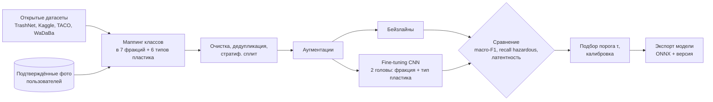
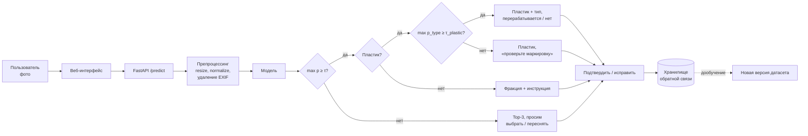

# ML System Design Doc: Waste Sorter

Классификация бытовых отходов по фотографии с подсказкой по утилизации.

---

## 1. Цели и предпосылки

### 1.1. Зачем идем в разработку продукта?

**Бизнес-цель.**
*  Облегчить задачу сортировки отходов для пользователя, тем самым понизив порог вхождения в привычку переработки, популяризировать её.
* Повысить долю правильно отсортированных бытовых отходов: пользователь
быстро и без поиска по справочникам узнаёт, в какой контейнер выбросить конкретный предмет.

**Проблема.**
- Правила сортировки неочевидны: чек на термобумаге не макулатура, тетрапак не картон,
  разбитая кружка не стекло. Люди ошибаются или бросают сортировать.
- Ошибки «загрязняют» вторсырьё. Партия с примесями дешевеет или уходит на полигон, поэтому переработчику важна чистота фракций.
- Текстовые справочники требуют знать название материала. Фото проще: не нужно разбираться в маркировке.

**Почему станет лучше от ML.** Правилами («если на фото бутылка, то пластик») задачу не
решить: предметов тысячи, внешний вид, освещение и фон сильно варьируются. Задача хорошо
решается классификатором изображений с transfer learning; открытые датасеты уже существуют.

**Что будем считать успехом итерации (MVP).**

| Тип | Метрика | Цель MVP |
|---|---|---|
| ML | Macro-F1 на отложенной выборке | ≥ 0.85 |
| ML | Recall класса `hazardous` | ≥ 0.90 (опасное нельзя пропускать) |
| ML | Macro-F1 по типам пластика (внутри класса `plastic`) | ≥ 0.70 |
| Продукт | Доля ответов «модель уверена» (top-1 prob ≥ порога) | ≥ 75 % |
| Продукт | Доля подтверждений пользователем («да, верно») | ≥ 80 % |
| Тех. | Латентность ответа API (p95, CPU) | ≤ 500 мс |

**Пользователи:**
- жители, которые хотят сортировать мусор дома (основной сценарий, так как это "тёплые" пользователи - уже готовы к переработке, сами пришли);
- офисы, кафе, школы, где у контейнеров можно поставить планшет с камерой (перспектива, я замечала, что у меня на работе коллеги не понимают, что куда можно выбрасывать);
- экоактивисты и организаторы раздельного сбора как источник обратной связи и разметки.

### 1.2. Бизнес-требования и ограничения

**Функциональные требования:**
1. Пользователь загружает или снимает фото, получает фракцию, уверенность и инструкцию.
   Для пластика дополнительно получает тип (PET, HDPE, LDPE, PP, PS) и признак
   «перерабатывается / нет».
2. При уверенности ниже порога сервис не угадывает, а предлагает переснять фото или выбрать фракцию вручную из 2–3 наиболее вероятных.
3. Пользователь может подтвердить или исправить ответ, и это сохраняется как новая разметка.
4. Инструкции по утилизации хранятся отдельно от модели (конфиг) и могут отличаться по региону.

**Нефункциональные требования и ограничения:**
- **Время ответа:** ≤ 1 с end-to-end, ≤ 500 мс на инференс (p95) на CPU без GPU.
- **Ресурсы:** учебный проект, бюджета на GPU-инференс нет/он небольшой. Модель должна работать на CPU
  (размер ≤ 50 МБ, лёгкая архитектура вроде MobileNetV3 / EfficientNet-B0).
- **Приватность:** на фото могут попасть люди и документы. Изображения храним только с
  согласия пользователя, без геолокации и EXIF; в датасет для дообучения попадают только
  подтверждённые фото.
- **Цена ошибки неравная.** Пропуск опасных отходов (батарейки, лампы) хуже всего, ошибка
  «пластик вместо металла» терпима. Это учитывается в метриках и порогах.
- **Региональность:** правила сортировки зависят от города и оператора. В MVP один
  универсальный набор фракций.
- **Сроки:** курсовой проект, MVP за семестр.

**Бизнес-процесс пилота.** Веб-демо (Streamlit или Gradio) поверх FastAPI. 2-5
тестовых пользователей (одногруппники, знакомые) используют сервис 1 неделю. Собираем
подтверждения и исправления, по ним считаем продуктовые метрики.

**Что считаем успешным пилотом:** выполнены цели из таблицы в п. 1.1 на реальных фото
пользователей (не только на тестовой выборке датасета).

**Возможные пути развития:** мобильное приложение с on-device моделью (TFLite / CoreML),
детекция нескольких предметов на одном фото, автоматические умные урны с камерой,
учёт региональных правил. Попробую предложить это как инициативу в своей компании.
Отдельное направление на будущее: распознаватель для конвейеров сортировочных станций
(см. раздел 6).

### 1.3. Что входит в скоуп проекта/итерации, что не входит

**Входит в MVP:**
- классификация одного предмета на фото по нескольким фракциям: `plastic` (несколько типов), `paper`, `glass`, `metal`, `organic`, `hazardous`, `other`;
- подклассификация пластика по типу: если предмет распознан как `plastic`, определяем
  тип полимера (см. п. 2.1);
- сбор и объединение открытых датасетов, маппинг их классов в наши 7 фракций
  и 5 типов пластика;
- бейзлайн и основная модель (transfer learning), сравнение по метрикам;
- REST API (FastAPI) и простой веб-интерфейс;
- порог уверенности и fallback на ручной выбор;
- сохранение подтверждений и исправлений пользователей;
- воспроизводимость: фиксированные сплиты, версии данных и моделей, линтеры, тесты.

**Не входит (технический долг / следующие итерации):**
- детекция и сегментация нескольких предметов на одном фото;
- мобильное приложение и on-device инференс;
- региональные правила сортировки и геолокация;
- физическое железо (умная урна, конвейер), распознаватель для конвейеров вынесен
  в план на будущее (раздел 6);
- автоматическое переобучение по расписанию (в MVP переобучаем вручную);
- распознавание маркировки (♳–♹) и OCR: в MVP тип пластика определяется по внешнему виду,
  чтение маркировки — возможное улучшение позже.

**Качество кода и воспроизводимость:** ruff и pre-commit с первого коммита, pytest,
фиксированные random seed, зависимости в `pyproject.toml`, данные и веса вне git
(в дальнейшем DVC и трекинг экспериментов в MLflow).

**Планируемый технический долг:** ручная разметка спорных случаев; веб-демо вместо
полноценного фронтенда; хранилище обратной связи в SQLite.

### 1.4. Предпосылки решения

- **Один предмет в кадре.** Пользователь фотографирует один предмет, поэтому задача
  сводится к классификации, а не к детекции. Это упрощает модель и разметку.
- **Данные.** Открытые датасеты:
  - [TrashNet](https://github.com/garythung/trashnet): ~2.5k фото, 6 классов, однородный фон;
  - [Garbage Classification (12 classes)](https://www.kaggle.com/datasets/mostafaabla/garbage-classification):
    ~15k фото, есть `battery`, `biological`, `clothes`, `shoes`;
  - [TACO](http://tacodataset.org/): фото «в дикой природе», для теста устойчивости
    (кропы по bbox);
  - [WaDaBa](http://wadaba.pcz.pl/): ~4k фото пластиковых отходов с разметкой по типу
    полимера (PET, PE-HD, PP, PS, Other), для подклассификации пластика.

  Классы датасетов маппятся в наши 7 фракций (например, `brown-glass`/`green-glass`/`white-glass`
  → `glass`, `battery` → `hazardous`, `clothes`/`shoes` → `other`).
- **Domain shift.** Студийные фото из TrashNet отличаются от фото пользователя на кухне.
  Нужны сильные аугментации (фон, освещение, повороты, blur), тест на TACO и на собственных
  фото, дальше дообучение на подтверждённых фото пользователей.
- **Тип пластика по фото определяется не всегда.** Бутылка из PET и бутылка из HDPE
  отличаются заметно, а плёнку LDPE и пакет из другого полимера визуально почти не
  различить. Поэтому у подклассификации свой порог уверенности; при низкой уверенности
  показываем только «пластик» и просим посмотреть маркировку на упаковке.
- **Дисбаланс классов.** `hazardous` и `organic` малочисленны. Нужны weighted loss или
  oversampling и контроль метрик по каждому классу, а не только accuracy.
- **Горизонт и гранулярность.** Предсказание делается по одному запросу в реальном времени,
  без батчевого режима.
- **Железо.** Инференс на CPU, поэтому выбираем лёгкие архитектуры и, при необходимости,
  экспорт в ONNX и квантизацию.

---

## 2. Методология

### 2.1. Постановка задачи

**Тип задачи:** иерархическая многоклассовая классификация изображений
(multi-class, single-label) в два уровня:

1. **Фракция**, 7 классов: `plastic`, `paper`, `glass`, `metal`, `organic`, `hazardous`, `other`.
2. **Тип пластика** (только если уровень 1 = `plastic`), 6 классов:

| Тип | Маркировка | Примеры | Перерабатывается |
|---|---|---|---|
| `pet` | ♳ 1 | бутылки от воды и напитков | да |
| `hdpe` | ♴ 2 | канистры, флаконы от бытовой химии | да |
| `ldpe` | ♶ 4 | плёнка, пакеты | да (принимают не везде) |
| `pp` | ♷ 5 | контейнеры для еды, крышки, стаканчики от йогурта | да |
| `ps` | ♸ 6 | одноразовая посуда, лотки | да (принимают не везде) |
| `non_recyclable` | ♵ 3, ♹ 7 | PVC, композиты, смешанный пластик | нет |

Подклассифицируются только перерабатываемые типы: PVC и «прочее» объединены в один класс
`non_recyclable`, их детальный тип пользователю не нужен.

**Архитектура:** общий бэкбон и две головы (фракция и тип пластика). Голова типа пластика
обучается только на примерах класса `plastic`. Альтернатива для сравнения: две отдельные
модели, вторая запускается только для пластика.

- **Вход:** RGB-изображение (после ресайза 224×224).
- **Выход:** вероятности по 7 фракциям; для пластика ещё вероятности по 6 типам;
  top-1 класс и уверенность на каждом уровне.
- **Решающее правило:** если `max(p) ≥ τ`, отдаём класс; иначе показываем top-3 и просим
  пользователя выбрать. Порог `τ` подбирается на валидации так, чтобы точность на «уверенных»
  ответах была ≥ 95 %. Для типа пластика свой порог `τ_plastic`: ниже него
  отдаём просто «пластик» без типа.

**Метрики:**
- основная: **macro-F1** (учитывает редкие классы);
- для типа пластика: macro-F1 по 6 типам и точность бинарного признака
  «перерабатывается / нет»;
- дополнительные: accuracy, per-class precision/recall, **recall(`hazardous`)**,
  confusion matrix, coverage при пороге `τ`, калибровка (ECE);
- технические: латентность инференса, размер модели.

**Бейзлайны (по возрастанию сложности):**
1. константный: самый частый класс (нижняя граница);
2. замороженный предобученный бэкбон (ResNet-18 / MobileNetV3), эмбеддинги
   и логистическая регрессия;
3. fine-tuning EfficientNet-B0 / MobileNetV3 с аугментациями и взвешенным лоссом;
4. (опционально) zero-shot CLIP с текстовыми промптами, для сравнения и разметки
   спорных фото.

**Валидация:** стратифицированное разбиение train/val/test (70/15/15), фиксированный seed.
Отдельный out-of-domain тест: кропы TACO и собственные фото, чтобы оценить domain shift.

### 2.2. Блок-схема решения

**Обучение (offline):**

**Инференс (online):**

### 2.3. Этапы решения задачи

| # | Этап | Результат | Критерий перехода дальше |
|---|---|---|---|
| 1 | Сетап репозитория, дизайн-документ | Репозиторий, линтеры, pre-commit, этот документ | Ревью ментора пройдено |
| 2 | Сбор данных и EDA | Объединённый датасет, маппинг классов, отчёт EDA | Не менее 300 изображений на класс |
| 3 | Бейзлайны | Метрики бейзлайнов 1–2 | Пайплайн обучения воспроизводим |
| 4 | Основная модель | Fine-tuned CNN, подобранный τ | macro-F1 ≥ 0.85, recall(hazardous) ≥ 0.90 |
| 4a | Подклассификация пластика | Голова типа пластика, порог τ_plastic | macro-F1 по типам ≥ 0.70 |
| 5 | Сервис | FastAPI + веб-демо, Docker | p95 ≤ 500 мс на CPU |
| 6 | Пилот | Отзывы 2–5 пользователей, сбор фидбэка | Продуктовые метрики из п. 1.1 |
| 7 | Мониторинг и дообучение | Дашборд метрик, дообученная модель | Метрики на реальных фото не падают |

---

## 3. Подготовка пилота

- **Способ оценки:** сравниваем ответы модели с подтверждениями и исправлениями
  пользователей. Считаем долю подтверждений, coverage при `τ`, per-class ошибки.
- **Что считаем успешным пилотом:** см. таблицу целей в п. 1.1.
- **Риски и что с ними делать:**

| Риск | Митигация |
|---|---|
| Domain shift (студийные фото против реальных) | Аугментации, out-of-domain тест, дообучение на фидбэке |
| Пропуск опасных отходов | Отдельный порог и повышенный вес класса `hazardous`, явное предупреждение в UI |
| Пользователи ничего не исправляют, фидбэка мало | Короткий сценарий «да / нет» в один клик |
| Неоднозначные предметы (композиты, тетрапак) | Класс `other` и текстовая подсказка, расширение таксономии позже |
| Фото с персональными данными | Удаление EXIF, хранение только с согласия |
| Тип пластика визуально неразличим | Отдельный порог τ_plastic, fallback на «пластик, проверьте маркировку» |
| Мало размеченных данных по типам пластика | WaDaBa + разметка подтверждённых фото пользователей |

## 4. Внедрение (черновик)

- **Архитектура:** веб-клиент → FastAPI → модель в памяти процесса (ONNX Runtime) →
  SQLite / Postgres для фидбэка. Упаковка в Docker.
- **Мониторинг:** латентность, ошибки API, распределение предсказанных классов и
  уверенности (data / prediction drift), доля исправлений пользователями.
- **Версионирование:** данные (DVC), эксперименты и модели (MLflow), код (git + PR-ревью).

## 5. Открытые вопросы

- Нужна ли отдельная фракция для тетрапака / композитных упаковок?
- Какой регион берём за эталон правил сортировки в MVP?
- Веб-демо или сразу Telegram-бот как более удобный канал для пилота?

## 6. План на будущее: распознаватель для конвейеров

После MVP хочу попробовать применить подход на сортировочных станциях, где отходы едут по
ленте конвейера. Это отдельный проект, в текущий скоуп он не входит.

**Чем задача отличается от MVP:**

| | MVP (приложение) | Конвейер |
|---|---|---|
| Тип задачи | Классификация одного предмета | Детекция и трекинг многих предметов в потоке |
| Вход | Фото с телефона | Видео с промышленной камеры над лентой |
| Скорость | ≤ 500 мс на фото | Десятки кадров в секунду, решение до того, как предмет уедет |
| Выход | Фракция для человека | Класс + координаты для манипулятора или пневмоотбойника |
| Цена ошибки | Пользователь переспросит | Загрязнение партии вторсырья |

**Что можно переиспользовать из MVP:** таксономию фракций и типов пластика, накопленный
датасет, бэкбон как основу для детектора.

**Возможные шаги:**
1. Найти данные с конвейеров: открытые датасеты (например,
   [ZeroWaste](https://github.com/dbash/zerowaste)) или запись видео на реальной станции.
2. Бейзлайн-детектор (семейство YOLO / RT-DETR), обученный на кадрах с ленты.
3. Трекинг предметов между кадрами, чтобы считать каждый предмет один раз.
4. Оптимизация под edge-устройство (Jetson, TensorRT) и замер FPS.
5. Пилот на одной ленте совместно с оператором сортировки.

**Открытые вопросы:** доступ к реальной станции и видео с неё; интеграция с исполнительными
механизмами; нужен ли гиперспектральный сенсор для надёжного определения типа пластика
(промышленные сортировщики обычно используют NIR-спектроскопию, а не только RGB).
