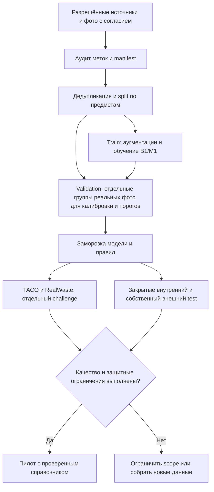
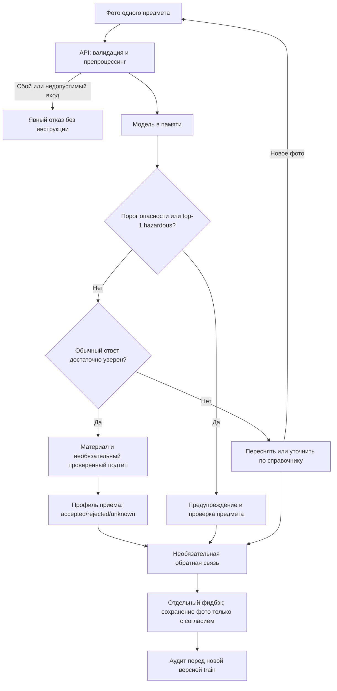

# ML System Design Doc: Waste Sorter

Классификация бытовых отходов по фотографии с осторожной подсказкой по утилизации.

Статус: ДЗ2. Проведены EDA изображений TrashNet и аннотаций TACO, запущены
B0 и цветовой baseline на четырёх материалах. [Отчёт и графики](../reports/eda/README.md).
Семиклассовая модель, API и пилот ещё не готовы. Цели MVP ниже остаются гипотезами;
измеренные результаты ДЗ2 отдельно приведены в п. 2.3 и отчёте.
Основания: [условие ДЗ2](https://gist.github.com/pacifikus/bada0e4b597852e4bb50512daf451929),
[условие ДЗ1](https://gist.github.com/pacifikus/47424379293e0874859354ecd130ba13)
и предоставленные занятия MLSD 1–6. Дизайн пересматривается после EDA;
критерии закрытого теста не меняются после просмотра результатов.

## 1. Цели и предпосылки

### 1.1. Зачем идём в разработку продукта

**Проблема.** Пользователь хочет сортировать отходы, но не знает материал предмета
или правила приёма. Например, форма упаковки не гарантирует состав, а состав сам
по себе не определяет, примет ли её конкретный оператор. Ошибочная подсказка может
загрязнить вторсырьё; пропуск батарейки или лампы имеет более высокую цену.

**Пользователи.** Жители, начинающие сортировать бытовые отходы дома.
Офисы и школы — возможные следующие площадки, но не целевая аудитория первого пилота.
Автор проекта отвечает за данные, эксперимент и приложение; независимый проверяющий
нужен для эталонной разметки и проверки инструкций до оценки качества.

**Бизнес-цель.** Увеличить долю корректно завершённых решений о сортировке и сократить
время поиска относительно краткого текстового справочника. Само число фотографий,
высокий confidence и нажатие «верно» не доказывают полезность продукта.

**Почему пробуем ML.** Фото может сократить поиск материала среди множества предметов.
Это гипотеза: визуально похожие предметы могут иметь разный состав, поэтому сравниваем
с ручным справочником и разрешаем отказ от ответа. Если ML не улучшает процесс,
сохраняем справочник; более сложная модель не является целью сама по себе.

Цепочка эффекта: фото → корректная идентификация → проверенная инструкция → решение
пользователя. Уменьшение реального загрязнения вторсырья потребует отдельного полевого
исследования; учебный пилот его не измеряет.

**Цели будущего MVP:**

| Уровень | Метрика | Проектный ориентир |
|---|---|---|
| Модель | Macro-F1 семи классов без порогов, внутренний закрытый test | ≥ 0.85 |
| Модель | Macro-F1 семи классов на собственном внешнем test | ≥ 0.75, отдельная гипотеза для реальных фото |
| Решение | Точность автоматически принятых обычных ответов | ≥ 0.95 при coverage ≥ 0.75 |
| Защитная | Доля опасных предметов, ошибочно получивших обычную инструкцию | ≤ 0.10 |
| Защитная | Recall предупреждения после решающего правила | ≥ 0.90; до порогов — отдельная диагностика |
| Продукт | Доля корректных решений против справочника | Не хуже; желаемый прирост ≥ 5 п.п. |
| Продукт | Медиана времени решения против справочника | Желаемое сокращение ≥ 20% |
| Система | p95 полного серверного `/predict` | ≤ 500 мс на заданном CPU |

Числа используются для планирования. Успех нельзя объявлять по точечной оценке
при недостаточном числе независимых объектов; протокол интервалов — в п. 2.1.

### 1.2. Бизнес-требования и ограничения

| ID | Требование | Критерий проверки |
|---|---|---|
| BR-01 | Оценить фото одного предмета | Ответ содержит класс или статус отказа, версии модели и правил |
| BR-02 | Не превращать неопределённость в обычную инструкцию | Пустое/неподдерживаемое фото, низкая уверенность и сбой дают явный отказ |
| BR-03 | Отдельно обрабатывать потенциально опасные отходы | Предупреждение имеет приоритет над обычным классом; контроль защитных метрик |
| BR-04 | Отделить материал от правил приёма | Без проверенного профиля оператора ответ о приёме — `unknown` |
| BR-05 | Собирать обратную связь с происхождением метки | Подтверждение пользователя хранится отдельно от проверенной разметки |
| BR-06 | Соблюдать ресурсные ограничения | CPU-инференс, артефакт ≤ 50 МБ, замер задержек и отказов под нагрузкой |
| BR-07 | Воспроизвести эксперимент | Хеши данных, manifest split, seed, код, зависимости и пороги сохранены |

**Региональность.** Для дизайна пилота выбираем Москву и двухпоточную схему
ЭкоЛайн: [описание исполнителя](https://ec-line.ru/rso/).
Профиль `moscow-ecoline-draft-v1`
описывает только обслуживаемые этой схемой площадки, а не все пункты Москвы.
Полный профиль и исключения фиксируем в [отдельном документе](pilot_policy.md).
Перед пользовательским пилотом проверяем актуальность правил на выбранной площадке.

В первой итерации показываем класс материала и общую подсказку
«проверьте правила местного оператора». Без выбранного и проверенного профиля
не обещаем конкретный контейнер и не возвращаем универсальный флаг переработки.
Для пилота инструкций используем только выбранный профиль: до запуска фиксируем
адрес площадки, ссылку на источник, дату проверки и версию профиля. Пока профиль
не готов, можно оценивать материал и usability, но не заявлять успех подсказок по приёму.

**Ограничения.** Один студент; учебная оценка — 50 часов на MVP за семестр:
15 ч данные/аудит, 12 ч baseline/эксперименты, 10 ч API/демо, 8 ч оценка/пилот,
5 ч резерв. После EDA пересматриваем план, при нехватке времени откладываем подклассы
пластика. CPU и существующий компьютер; платные API не нужны. Лимит дополнительных
расходов — 2 000 ₽ на семестр, любая потребность сверх него требует сокращения scope.
Это бюджетное допущение, а не оценка рыночной стоимости разработки.

**Производительность.** Клиент до отправки уменьшает длинную сторону до 1280 px
и сжимает фото до целевого размера ≤ 500 КБ, показывая ошибку, если это не удалось.
Сервер всё равно проверяет собственные лимиты. На канале 20 Мбит/с передача 500 КБ
занимает около 0.2 с без учёта RTT; загрузка исходника 3–4 МБ не укладывается
в обещание секунды. Сжатие на клиенте — план реализации, пока интерфейса нет.

Стартовый стенд: 2 vCPU, 4 ГБ RAM, 1 worker, прогретая модель,
1 запрос/с в течение 10 минут, JPEG/PNG ≤ 5 МБ и ≤ 12 Мп. Считаем p50/p95,
долю ошибок и RSS; в серверную задержку включаем декодирование и препроцессинг,
но не загрузку по сети. Инференс измеряем отдельно. Ориентир end-to-end ≤ 1 с
проверяем отдельно с указанием сети; без такого замера он не считается выполненным.

**Приватность.** По умолчанию фото обрабатывается в памяти без сохранения. Хранение
для исследования — только по отдельному согласию. Удаляем EXIF при перекодировании,
не пишем изображения и payload в логи. EXIF не удаляет лица и текст на фото:
перед включением в датасет проверяем содержимое. Кадры с людьми, документами
и другими личными данными исключаем: согласие загрузившего не означает согласия
посторонних людей. Пересъёмка предмета предпочтительнее сохранения такого кадра.
Добровольно сохранённые исходники удаляем через 30 дней; пользователь может запросить
удаление по случайному ID. Согласие и проверка метки — разные условия включения в train.

### 1.3. Что входит в scope

**ДЗ1 (выполнено):** дизайн, README, пакет классов, pytest, Ruff и pre-commit.
**ДЗ2 (текущая поставка):** загрузка закреплённых источников, фактический EDA,
manifest/mapping/split, графики с выводами, дешёвый baseline и расширенные этапы.
Полноценная семиклассовая модель, API и пилот пока не реализованы.

**MVP:** семь классов; аудит и объединение разрешённых источников; baseline и лёгкая
CNN; отказ от ответа и предупреждение об опасности; FastAPI и веб-демо; отдельный
сбор фидбэка; независимая оценка; ручное переобучение и версии артефактов.

**Условное расширение:** подклассификация пластика только после подтверждения покрытия
и достоверных меток. Она не блокирует базовый MVP. Принятие конкретным оператором
определяется отдельным проверенным профилем, а не головой нейросети.

**Вне scope:** детекция нескольких объектов, OCR маркировки, геолокация и каталог
операторов, мобильное приложение, автоматическое переобучение, физическая сортировка,
гарантия распознавания любых опасных отходов. Конвейер — отдельная будущая задача (п. 6).

Технический долг: веб-демо вместо приложения, SQLite, ручной аудит и публикация модели.
Фиксируем окружение эксперимента вместе с версиями библиотек; текущие диапазоны
в `pyproject.toml` сами по себе не гарантируют воспроизводимость обучения.

### 1.4. Предпосылки решения и данные

| Допущение | Проверка | Если не выполнено |
|---|---|---|
| Один видимый предмет | Инструкция съёмки, challenge с пустыми и многопредметными фото | Пересъёмка; не выдаём одну инструкцию нескольким предметам |
| Материал различим на фото | Проверенная разметка и разбор ошибок | Отказ, запрос маркировки или справочник |
| Источники разрешены к использованию | Проверка лицензии, версии и доступа до загрузки | Исключить источник |
| Есть независимая проверка меток | Второй проверяющий и разбор разногласий | Только предварительный отчёт, без заявления об успехе |
| Реальные фото отличаются от учебных | Закрытый набор телефонов/фонов | Ограничить вывод доменом исходных данных |

В ДЗ2 проверены изображения TrashNet и аннотации TACO. Остальные источники ниже —
кандидаты, а не уже собранный объединённый датасет. Размеры, лицензии и mapping
проверяются для конкретного снимка; фактические выводы — в п. 2.3 и отчёте EDA.

| Источник | Планируемое использование | Ограничение/аудит |
|---|---|---|
| [TrashNet](https://github.com/garythung/trashnet) | Базовые материалы; `cardboard` и `paper` → `paper` | Однородный фон; `trash` не считать автоматически `other` без проверки |
| [Garbage Classification](https://www.kaggle.com/datasets/mostafaabla/garbage-classification) | Цвета стекла → `glass`, `battery` → `hazardous`, `biological` → `organic` | Проверить происхождение и пересечения с другими источниками; батарейки не покрывают все опасные отходы |
| [TACO](http://tacodataset.org/) | Отдельный challenge из кропов | Все кропы исходной сцены в одной группе; перенос категорий требует аудита |
| [WaDaBa](http://wadaba.pcz.pl/) | Только эксперимент PET/HDPE/PP/PS | PVC и LDPE отсутствуют; Other слишком мал. Получение по форме/соглашению — зависимость этапа данных, не гарантированный доступ |
| [RealWaste](https://archive.ics.uci.edu/dataset/908/realwaste) | Только внешний challenge, не train и не калибровка | CC BY 4.0; нет класса hazardous, поэтому не доказывает полноту семиклассового MVP |
| Собственные фото с согласием | Закрытая оценка реальных условий | Группы по физическому предмету/сессии; независимая разметка |

**Покрытие пластика.** По замечанию ревьюера WaDaBa содержит 100 предметов,
снятых с повторными ракурсами: PET 57, HDPE 15, PP 14, PS 13, Other 1.
Это сведения ревью, подлежащие сверке с полученным снимком: опубликованная
[таблица исследования](https://www.oaepublish.com/articles/ir.2021.15) также
подтверждает отсутствие PVC/LDPE и малочисленность Other, но её количества
изображений отличаются от пересказа сайта. Не смешиваем эти версии в одном отчёте.
ID предмета извлекаем из имени файла по проверенной схеме; 40 ракурсов не дают
40 независимых объектов. В 15% test останется примерно по два предмета редких
полимеров: этого недостаточно для подтверждения цели F1. Нужен собственный сбор
новых предметов с маркировкой; если доступ или сбор не получены, расширение отложено.

**Покрытие hazardous.** Начальная подтверждаемая область — батарейки.
Лампы, электроника и другие опасные предметы не обещаются как распознаваемые:
они входят в challenge и запрос уточнения. Расширяем область только после
самостоятельного сбора и проверки соответствующих подклассов. Наличие названия
`hazardous` не делает батарейный test проверкой всех опасных отходов. Числа фото
из ревью не используем как результаты собственного аудита.

**Права на данные.** Garbage Classification включает веб-снимки; автор
[указывает исследовательское использование и права исходных фотографов](https://www.kaggle.com/code/mostafaabla/garbage-classification-keras-transfer-learning/input).
Для каждого источника сохраняем условия конкретного снимка; MIT у кода TACO
не является лицензией всех изображений. Перед использованием его фото проверяем
метаданные прав каждого файла. WaDaBa требует проверки условий выдачи. Эти источники
не считаем автоматически разрешёнными для коммерческого продукта или публичного
распространения весов; при неясных правах используем собственные разрешённые фото.

Для каждого изображения manifest хранит ID, SHA-256, источник/лицензию/версию,
группу предмета/сцены, исходную и целевую метку, происхождение разметки и split.
Неоднозначные метки получают `unresolved`, не подменяются классом `other`.
После аудита публикуем число независимых предметов и распределение классов по источникам.
Ресэмплинг и веса применяем только к train; недостаток покрытия не исправляется весами.

**Матрица относительной цены решений.** Это экспертные приоритеты для обсуждения,
не рубли и не измеренный ущерб. Для принятого оператором предмета обычный совет
верен; «не принят» здесь означает именно выбранную схему, а не универсальное свойство.

| Истинный исход | Верный маршрут | Ошибочно во вторсырьё | Ошибочно в смешанные | Уточнение/отказ |
|---|---|---|---|---|
| Опасный предмет | Специальный сбор: 0 | Очень высокая | Очень высокая | Задержка, отдельное предупреждение обязательно |
| Не принят выбранной схемой | Проверенный иной маршрут: 0 | Высокая: загрязнение | Зависит от правил | Низкая |
| Принят выбранной схемой | Приём вторсырья: 0 | 0 | Средняя: потеря вторсырья | Низкая |

Macro-F1 остаётся диагностикой материала; неравную цену учитывают порядок правил,
защитные метрики и ограничения порогов. До оценки ущерба не оптимизируем выдуманную
денежную функцию потерь.

## 2. Методология

### 2.1. Постановка задачи

**Базовая задача:** single-label классификация одного предмета, семь классов:
`plastic`, `paper`, `glass`, `metal`, `organic`, `hazardous`, `other`.
`other` — проверенный предмет вне первых шести категорий, а не неизвестность модели
и не утверждение о невозможности переработки. Смешанные материалы без однозначной
метки отправляем на разбор; правила для них фиксируются в инструкции разметчика.
`hazardous` оцениваем по фактически собранным подклассам (вначале батарейки);
результат только на батарейках не обобщаем на весь опасный мусор.

**Вход:** JPEG/PNG одного предмета, RGB, resize 224×224 и нормализация выбранного
бэкбона; одинаковый препроцессинг в train и serving. **Выход будущего API:**
`request_id`, `status` (`classified`, `hazard_warning`, `needs_review`, `invalid_input`),
класс/вероятности если доступны, `model_version`, `preprocessing_version`,
`policy_version` или null, `acceptance` (`accepted`, `rejected`, `unknown`).
Timeout и повреждённое фото возвращают типизированную ошибку без рекомендации.
Отсутствие профиля или нужных сведений о предмете означает `acceptance=unknown`.

**Решающее правило, в порядке приоритета:**

1. Проверить формат, размер, декодирование и допустимость входа; при сбое отказать.
   Пустые и неподдерживаемые изображения — отдельный challenge: высокий softmax
   не доказывает, что вход относится к задаче. Автодетектор таких случаев пока гипотеза.
2. Если `p(hazardous) ≥ τ_h`, показать предупреждение о возможной опасности и запросить
   проверку предмета; обычную инструкцию не показывать даже при другом top-1.
3. Иначе, если top-1 = `hazardous`, также показать предупреждение. Если обычный top-1
   имеет `max(p) < τ`, вернуть `needs_review`: переснять/проверить маркировку/справочник.
4. Только уверенный обычный ответ проходит к проверенному профилю приёма.
   Top-3 — варианты для уточнения, а не три одновременные инструкции.

Калибровку и пороги выбираем внутри validation (групповые части для калибровки
и настройки порога). Она включает отдельные реальные фото из целевых условий,
не пересекающиеся с внешним test. Порог со студийных фото сам по себе не гарантирует
95% точности на телефоне. Совместно ищем `τ_h` и `τ`, удовлетворяющие защитной метрике,
точности и coverage. Если совместного решения нет, автоматические советы не запускаем:
обсуждаем scope/данные, не снижаем пороги после просмотра test.

**Пластик — исследовательская ветка.** Четыре кандидата: `pet`, `hdpe`, `pp`, `ps`.
LDPE, PVC и прочий пластик не входят в обучаемую таксономию этой итерации:
ответ для них — «пластик, проверьте маркировку», без догадки и без вывода о приёме.
Даже высокий softmax четырёх классов не доказывает, что неизвестный полимер входит
в поддерживаемый набор: перед автоподтипом нужны challenge и достаточная способность
отказа; до этого подтип остаётся экспериментальным, в пользовательский совет не идёт.
Для каждого типа нужны доступный источник, метка по маркировке/документации,
а не по форме, и независимые предметы. Общий бэкбон с дополнительной головой
сравнивается с отдельным классификатором; loss типа маскируется без достоверной метки.
Ориентир macro-F1 ≥ 0.70 по четырём типам — исследовательский, не gate базового MVP.
Дополнительно считаем сквозное качество на всех истинно пластиковых предметах,
включая ошибки первого уровня, неподдержанные полимеры и отказы. Публикуем
число предметов каждого типа и интервалы, а не только число их снимков.

**Baseline и сравнение:**

- B0: самый частый класс — нижняя граница; не кандидат для пользовательских советов.
- B1: замороженный MobileNetV3, эмбеддинги и логистическая регрессия.
- M1: fine-tuning MobileNetV3; EfficientNet-B0 только при ресурсе на сравнение.
- Для продукта: тот же проверенный текстовый справочник без ML.

Все модели получают одинаковые split и правила оценки; выбор победителя на validation.
Сравниваем macro-F1, защитные метрики, точность/coverage, задержки и размер. Если более
сложная модель не даёт убедительного преимущества при тех же ограничениях, оставляем B1.
Абляции: веса классов и аугментации по отдельности; показываем learning curves.

**Защита от утечки.** Сначала аудит, точная и близкая дедупликация между источниками,
затем групповой train/validation/test примерно 70/15/15 с контролем баланса классов.
Один физический предмет, его ракурсы, одна исходная сцена и её кропы — в одной группе.
При неизвестных группах используем similarity-аудит и явно указываем остаточный риск.
Train-аугментации не попадают в validation/test; любые обучаемые преобразования — только
на train. Seed и manifest split заморожены. TACO-challenge и собственные test-фото
не участвуют ни в обучении, ни в выборе порогов. Повторная разработка после test
требует новой независимой оценки. Отдельно показываем срезы источник/фон/устройство,
редкие классы и новые типы предметов. Внутри train/validation дополнительно
проводим leave-one-dataset-out по доступным источникам: модель не видит исключённый
источник при обучении и настройке. Если класс есть только в исключённом источнике,
фиксируем отсутствие обучающей поддержки, а не скрываем его средним F1.
Окончательные TACO/RealWaste остаются закрытыми и не становятся набором для
повторной настройки по результатам этих опытов.

**Контракты метрик.** Владелец отчёта — автор проекта; источник меток — проверенный
manifest. Окно offline-оценки — замороженная версия test, а не текущий поток фидбэка.

| Метрика | Числитель / знаменатель и обработка отказов |
|---|---|
| Macro-F1 | Среднее F1 семи классов по top-1 до порогов; не исключаем сложные примеры |
| Обычная точность | Верные обычные автоматические ответы / все обычные автоматические ответы |
| Coverage | Число обычных автоматических ответов / все валидные входы основного test |
| Опасная рекомендация | Истинно опасные предметы с обычным автоматическим ответом / все истинно опасные предметы |
| Recall предупреждения | Ответ `hazard_warning` / все истинно опасные предметы после правила, по подклассам |
| Recall top-1 hazardous | Верный top-1 hazardous / все истинно опасные предметы до порогов; диагностика |
| Ложное предупреждение | Предупреждения на неопасных / все неопасные предметы |
| Продуктовая корректность | Верные завершённые решения / все назначенные задания, включая отказ/незавершение |

Показываем также confusion matrix, per-class precision/recall, ECE с размерами бинов,
доли предупреждений/отказов и ошибочных автоматических ответов на challenge.
Отказ не считается верной классификацией; он может предотвратить опасную рекомендацию,
но уменьшает coverage. Top-3 и `needs_review` не считаются обнаружением опасного предмета,
поскольку сами по себе не предупреждают об опасности. Отдельно показываем
опасные обычные ответы, предупреждения, отказы и ошибки API.
При нулевом знаменателе метрика неопределена.

Ориентир после EDA — ≥ 100 независимых предметов на класс в test, включая ≥ 100
опасных из заявленной области (сначала батарейки разных типов). Лампы и техника
попадают в gate только после расширения области и независимого сбора.
Это план сбора, а не гарантия точности оценки:
при recall 0.90 и 100 независимых опасных предметах неопределённость ещё существенна.
Для долей приводим 95% интервалы, для агрегатов и разниц моделей — парный bootstrap
по группам предметов/сессий с полным пересчётом метрик. Для успешного offline-gate
на основном внешнем test нижние границы точности, coverage и recall предупреждения
должны достигать целей, верхняя граница
опасной рекомендации — быть ≤ 0.10; иначе результат предварительный. Не обещаем
доказать прирост 5 п.п. без расчёта мощности. Если данных мало, публикуем ограничение
и план сбора, не выдаём число изображений за число независимых наблюдений.
Отдельно публикуем внутренний F1 (цель 0.85) и внешний F1 на собственных фото
(цель 0.75); внутренний успех не заменяет внешний. Для RealWaste считаем
качество на поддерживаемом пересечении классов с явным mapping; отсутствие
hazardous отмечается, F1 по этому пересечению не сравниваем напрямую с семиклассовым.

### 2.2. Блок-схемы решения

**Обучение и оценка:**

**Будущий инференс:**

### 2.3. Этапы решения задачи

Этапы ниже описывают поставку ДЗ2 и дальнейший путь к MVP. Числа о данных
получены в [EDA от 14.11.2026](../reports/eda/README.md), а цели качества остаются
проектными требованиями. Запуск на четырёх материалах не закрывает семиклассовый MVP.

#### Этап 1. Подготовка данных

**Сущности и фактически доступные данные.**

- `source_snapshot`: URL, revision, SHA-256 и роль источника. В ДЗ2 загружены полный
  resized-архив TrashNet и официальный JSON аннотаций TACO; контрольные суммы
  закреплены в `configs/data_sources.json` и проверяются до анализа.
- `image`: относительный ID, исходная метка, байты, размеры, режим, наличие EXIF,
  SHA-256 файла и декодированных пикселей, показатели яркости/резкости, статус чтения.
  Все 2 527 изображений TrashNet декодированы. Ошибок чтения нет, все 512×384 RGB.
- `annotation/scene`: 4 784 объекта на 1 500 сценах TACO, исходная категория,
  bbox, ссылочная целостность, площадь относительно сцены, известность лицензии.
  В этой итерации изображения TACO не загружены; качество пикселей не проверялось.
- `label`: версия mapping, источник и статус доверия. TrashNet `paper` и `cardboard`
  дают 997 примеров `paper`; `glass` — 501, `plastic` — 482, `metal` — 410.
  137 примеров `trash` требуют разбора и не становятся автоматически `other`.
- `candidate_group/split`: консервативные компоненты похожести, seed, train/validation/test
  или причина карантина. Это не восстановленные ID физических предметов.

**Обнаруженные проблемы и действия.**

| Наблюдение EDA | Решение и ограничение |
|---|---|
| Три пары полностью одинаковых файлов с разными метками материала | Карантин конфликтов, без автоматического выбора «верной» метки. Перед обучением новой версии — проверка предмета/источника и одна каноническая запись |
| 547 пар при dHash distance ≤ 4; видны ложные совпадения и большой компонент из 113 изображений | dHash — очередь визуального разбора, не доказательство дубля. Текущий split консервативный и предварительный, качество после карантина не переносим на исходную совокупность |
| 34 флага низкого контраста и 65 низкой резкости | Очередь проверки, не автоматическое удаление. Белый фон и прозрачная тара сами могут давать такие значения |
| Нет organic, hazardous и проверенного other в тренировочном источнике | Не обучать фиктивные классы и не считать их качество; до сбора данных ограничить исследование четырьмя материалами |
| Нет подтверждённых меток полимеров | Не выводить PET/HDPE/PP/PS по общему классу plastic; подтипы отложены |
| В TACO только 2 Battery и 8 Food waste; 890 многопредметных сцен | Только отдельный challenge после проверки прав, изображения и кропов; не заменяет полноценный hazardous test |
| В TACO два повторных annotation ID и семь некорректных bbox | Карантин соответствующих аннотаций, разбор первоисточника; никакой тихой обрезки рамок или перезаписи по ID |
| У 715 сцен TACO отсутствует license ID, а список определений лицензий пуст | Проверить права каждого файла: имеющиеся у 785 сцен ID тоже не разрешаются по этому JSON. MIT toolkit не является правом на все фото |

**Откуда и как поступают данные.** Для ДЗ2 — разовый HTTP-download двух закреплённых
файлов, без авторизации. Скрипт `scripts/download_data.py` сначала проверяет кеш,
скачивает во временный `.part`, сверяет SHA-256 и только затем принимает файл.
Аудит читает JPEG из ZIP без распаковки и аннотации из JSON. Сырые данные хранятся
в игнорируемой `data/raw`, агрегаты, manifest и графики — в `reports/eda`.
Автообновления нет. Новая версия источника означает новые checksum, аудит и manifest.

Следующий источник — собственные фото с независимой проверкой материала,
маркировкой полимера и согласием на хранение. Собираем их пакетами вручную;
привязываем ракурсы к предмету и сессии. Фидбэк не подмешивается в текущий test.
Garbage Classification, WaDaBa и RealWaste ещё не загружены в эту итерацию,
их наличие в списке кандидатов не означает проведённого EDA.

**Достаточность и план дополнительного сбора.** Текущий внутренний test включает
343 изображения четырёх материалов, но не является независимым тестом на кухонных фото.
Для оставшихся трёх классов в train нет пригодных примеров. Стартовый план —
по 300 новых уникальных предметов `hazardous` (вначале батарейки), `organic`
и проверенного `other` с раздельными группами, всего минимум 900. Это первый
ориентир сбора, не доказательство достаточности: по 15% получится около 45 test-групп
на класс, что недостаточно для строгого подтверждения recall 0.90.
Для финального gate требуется не менее 100 независимых test-предметов каждого
заявленного класса; например, при доле test 15% нужно ориентировочно 667 независимых
предметов на отсутствующий класс, если нет отдельного целевого сбора test.
Точный бюджет уточняется по интервалам и learning curves, а не по числу ракурсов.

Отдельно собираем 100–200 своих фото для ранней реальной validation/test по предметам
и 30–50 трудных случаев (чеки, керамика, композиты, неизвестный полимер, пустые кадры).
Этот малый набор позволяет выявить ошибки, но сам по себе не подтверждает gate.
Полимеры не добавляем в обязательную поставку, пока нет достаточных независимых
маркированных предметов и разрешённого источника. Аугментации не считаем новыми предметами.
Если данные недоступны, результат этапа — ограниченный четырёхклассовый эксперимент,
а выдача пользовательских советов и семиклассовый запуск остаются заблокированными.

**Конфиденциальность и права.** EXIF отсутствует во всех проверенных JPEG TrashNet,
но это не означает отсутствия персональных данных в пикселях. Визуальный скрининг
30 фото показал печатные материалы и этикетки; полного аудита PII не было.
Это не независимая экспертная переразметка. Перед использованием новых снимков
исключаем людей, документы и идентифицирующий текст, не храним сырой payload в логах.
Собственные фото сохраняются только по согласию и правилам удаления п. 1.2.
В репозиторий добавлены статистики и имена файлов, а не исходные фотографии.
Лицензии и атрибуция источников приведены в отчёте.

**Результат этапа.** Проверенные snapshots, машиночитаемый manifest, versioned mapping,
отчёт качества с графиками, список конфликтов/карантина, предварительный split
и количественный план сбора. Приёмка: входные checksum совпадают; все изображения
учтены, включая нечитабельные; ни одна известная группа не пересекает split;
неподдержанные классы и неустановленные права явно отмечены. Выход ДЗ2 уже сохранён,
экспертная разметка и реальный независимый test ещё не готовы.

#### Этап 2. Подготовка прогнозных моделей

**Цели, функции потерь и метрики.** Материал — multiclass single-label.
Планируем cross-entropy; при дисбалансе сравниваем обычную и взвешенную CE.
Веса вычисляются только по train, нормируются; вес и sampler одновременно
без отдельной абляции не включаем. Для optional-головы полимера loss маскируется,
когда нет подтверждённого типа; коэффициент головы выбирается на validation.
Никакого таргета `non_recyclable` по одному материалу.

Основная offline-метрика — macro-F1, потому что частый `paper` после mapping
преобладает (997 против 410 для metal). Отдельно precision/recall каждого класса,
confusion matrix, качество по источнику/фону и интервалы по независимым группам.
Macro-F1 не заменяет контроль цены ошибок: после появления опасного класса
измеряем recall предупреждения, долю опасных обычных советов, ложные предупреждения,
точность принятых обычных ответов и coverage. Отказы и `needs_review` не скрываем.
Время API, инференса, размер артефакта и память проверяются отдельно от качества.
Пороговые контракты и порядок `τ_h`/`τ` заданы в п. 2.1; на четырёх классах
нельзя подтвердить recall опасного класса, калибровку реальных фото или весь MVP.

**ML-валидация.** Текущий seed 42, stratification по метке группы, доли приблизительно
70/15/15. Точные/похожие изображения связываются до split; конфликты и `trash`
в карантине. Получено 1 568 train, 338 validation, 343 test, 278 исключённых записей;
пересечений известных candidate-групп между split нет. dHash не распознаёт надёжно
разные ракурсы одного предмета: эта версия split не считается подтверждённо независимой.
После аудита групп/новых предметов создаём следующую версию manifest.

Вычисляемая предобработка и scaler учатся на train. Аугментации — только train;
метрики считаются на неизменённых изображениях. Для моделей с настройкой
используем внутреннюю групповую CV внутри train и отдельные реальные группы
validation для калибровки и порогов. Все кандидаты сравниваются на одинаковых группах.
Текущий test для метрик моделей не открывался; профиль качества пикселей и состав
проверены в EDA. Внешний challenge TACO не участвует в выборе признаков/порогов.
При появлении второго train-источника — leave-one-dataset-out с явным указанием
классов без поддержки. Итоговый тест после заморозки конфигурации открываем один раз.

**Уже посттроенные baselines**

- B0: `DummyClassifier(strategy="most_frequent")`, класс выбирается по train.
- B_color: 16-bin RGB-гистограммы + среднее и std по каналам (54 признака),
  `StandardScaler` по train, логистическая регрессия с balanced class weights,
  `C=1`, `max_iter=2000`, seed 42. RGB resize 64×64; аугментаций нет.
  Функция потерь — регуляризованная multinomial log-loss. Никакого поиска
  гиперпараметров по этой validation в ДЗ2 не проводилось.

На 338 validation-изображениях четырёх материалов B0 macro-F1 = **0.1464**,
B_color = **0.5966**.
Скрипт `python -m waste_sorter.baseline` не загружает test-пиксели, сохраняет
метрики и predictions validation. Матрица ошибок и интерпретация — в отчёте.

**Следующие модели и развитие.** B1 — замороженный MobileNetV3 с предобученными
эмбеддингами и логистической регрессией; он ещё не запускался. B_color не заменяет
и не выдаётся за этот transfer-learning baseline. После B1 — fine-tuning MobileNetV3;
EfficientNet-B0 только при ресурсе. Эксперименты по одному изменению: веса классов,
аугментации яркости/контраста/поворотов, замена фона при сохранении предмета.
Геометрические преобразования не должны обрезать важную маркировку.
Сначала learning curves и ошибки, затем ограниченный поиск LR/weight decay/C.
Бюджет: до 6 конфигураций на модель и 3 seed для финалистов при доступном ресурсе;
фактические данные, время и конфигурации фиксируем. Выбираем простейшую модель,
удовлетворяющую ограничениям; улучшение оцениваем парно по группам.

**Анализ и интерпретация.** B_color хуже различает стекло и пластик; цвет и фон
не доказывают состав. Анализируем уверенные ошибки, качество по классам,
влияние фона/этикетки, разные устройства и ошибки на нетипичных предметах.
Для линейного baseline — коэффициенты признаков после scaler и примеры ошибок,
для CNN — карты внимания как способ расследования, не доказательство причинности.
Проверяем калибровку и риск/coverage на целевых реальных данных, сравниваем
модель с обычным справочником; уточнение полимера не принимаем за истину без маркировки.

| Риск | Снижение |
|---|---|
| Дубли и ракурсы дают завышенное качество | Группы до split, экспертный разбор candidate-пар, отдельные предметы/сессии |
| Карантин dHash меняет состав выборки | Публикация исключений и причины; ручной разбор ложных совпадений; новая версия split |
| Цветной фон или источник заменяет признак материала | Абляции фона и срезы, внешняя проверка; не обещать перенос по внутренней метрике |
| Нет hazardous/organic/other | Целевой сбор; не включать фиктивные вероятности и не запускать советы |
| Подбор по test | Заморозка и один финальный запуск; при изменении решения новая независимая оценка |
| Совместно недостижимы precision/coverage/recall | Сохранить справочник или ограничить scope; не менять критерии после test |
| Обучение не укладывается в ресурс | Замороженные эмбеддинги, меньшая модель, ограниченный поиск, отказ от optional-подтипов |

#### Этап 4. Сервис, воспроизводимость и нагрузка

FastAPI принимает только допустимые JPEG/PNG, ограничивает байты и декодированный
размер; нормализация соответствует модели. Клиентское сжатие, таймаут, повреждённый
файл, отсутствие модели и неизвестная версия дают явный отказ. Модель загружается
один раз; в ответе версии модели, mapping, препроцессинга и правил, случайный request ID.
Обучение отделено от serving, данные и веса вне git, набор зависимостей фиксирован.

Проверяем прогретый CPU-стенд, p95 полного серверного запроса ≤ 500 мс, память,
ошибки и размер артефакта ≤ 50 МБ; условия нагрузки заданы в п. 1.2. Отдельно
измеряем передачу фото и end-to-end, не подменяем их временем инференса.
**Результат:** контейнер, описание API, нагрузочный отчёт, smoke/regression проверки
и возможность rollback. Главный риск — расхождение train/serving; снижаем его
общей функцией препроцессинга и регрессионными примерами. Этот этап ещё не реализован.

#### Этап 5. Пилот, обратная связь и ручное обновление

До пилота проверяем эталонные материалы и профиль правил. Проводим usability
с 2–5 участниками и сравнение со справочником по протоколу п. 3: разные предметы
между условиями у одного человека, баланс сложности, доля верных завершений,
время и незавершённые задания. Малая группа даёт формативные наблюдения,
не статистически доказанное улучшение сортировки на популяции.

Фидбэк хранится отдельно от эталона. Фото — только с согласием и сроком удаления,
без людей/документов; новый train — после аудита, без пересечений с test.
Мониторим ошибки, отказы, предупреждения, задержку и изменения входных данных;
confidence drift не выдаём за измеренное падение точности.
**Результат:** отчёт пилота, проверенная очередь новых данных, решение продолжать,
сократить scope или оставить справочник. Риски малого покрытия и самоподтверждения
снижаем независимым эталоном, случайной частью аудита и запретом автообучения
на кнопке «верно». Пилот в ДЗ2 не проводился.

## 3. Подготовка пилота

**Usability:** 2–5 добровольцев, одна неделя. Проверяем понятность статусов, успешность
загрузки, время и причины отказов. Это малый формативный пилот, не доказательство
роста качества сортировки на популяции.

**Контрольные наборы до пилота.** Первый достижимый этап — 100–200 собственных
фото с независимой разметкой материала и правил выбранной схемы. Часть предметов
выделяем для реальной validation, часть — для закрытого внешнего test; они не
пересекаются ни по предметам, ни по сессиям с train и фидбэком. Это стартовый набор,
не достаточное основание заявить все цели: при нехватке опасных объектов и широких
интервалах gate не пройден. Затем увеличиваем test до покрытия из п. 2.1.
Отдельные 30–50 трудных предметов/кадров: чеки, композитная упаковка, керамика,
плёнка неизвестного полимера, загрязнённая тара, лампы/электроника, несколько предметов,
пустой кадр, человек/документ (только разрешённые тестовые макеты без личных данных).
Для каждого фиксируем требуемое уточнение/предупреждение и допустимость инструкции.
Эти кадры не используются для дообучения или настройки порогов. Если уверенные ошибки
не устраняются, ограничиваем приложение проверенными типами предметов и справочником.
Нельзя автоматически считать, что модель распознала чек по общему классу paper.

**Сравнение со справочником:** до запуска фиксируем набор предметов с проверенными
материалами и правилами выбранного оператора. Задания распределяем между условиями
«справочник» и «ML + тот же справочник», балансируем сложность и порядок.
Стартовый ориентир — 20 разных заданий на участника, распределённых между условиями. Один человек
не решает один и тот же предмет дважды, чтобы не измерять запоминание. Сохраняем
назначение задания, старт, завершение, ответ, версии и факт показа подсказки.
Оценщик сверяет решения с эталоном без знания условия. Разногласия разбираются;
неустановленный эталон исключается с причиной до анализа результатов.

Считаем корректность всех назначенных заданий, время завершённых и долю незавершений
по условиям. Для времени вместе с медианой обязательно показываем незавершения,
иначе быстрые отказы создадут ложный выигрыш. Интервалы учитывают повторные задания
участников и предметов; до расширенного пилота оцениваем требуемое число участников
и заданий по вариативности и целевому приросту 5 п.п. Если данных не хватает,
формулируем вывод как наблюдение о usability, а не подтверждённый эффект.

**Обратная связь не эталон.** Нажатия «верно/неверно» — сигналы доверия и кандидаты
на аудит; отсутствие оценки не считается успехом. В train поступают только фото
с согласием, проверенной меткой и отсутствием пересечений с закрытыми наборами.

**Решение после пилота:** продолжаем, если нет нарушения защитных ограничений,
есть проверяемая польза и ресурс на поддержку. При опасных автоматических советах
останавливаем выдачу инструкций и оставляем справочник. Если эффект неопределён,
расширяем независимую оценку; если справочник не хуже, упрощаем продукт.

## 4. Внедрение, мониторинг и риски

Будущая архитектура: веб-демо → FastAPI → CPU-модель в памяти процесса → отдельный
профиль правил; SQLite для добровольного фидбэка. Docker, фиксированные версии
модели/препроцессинга/правил; предыдущий проверенный артефакт для rollback.
При недоступности модели — справочник и явный отказ, без выдуманного результата.

Контролируем задержки, RSS, ошибки, отказы, предупреждения, распределение классов
и coverage. Дрейф confidence — сигнал проверки, не доказательство падения качества.
Качество измеряется по отдельно проверяемой выборке с известной задержкой разметки.
Перед каждой публикацией — неизменяемый regression-набор, проверка совместимости
препроцессинга, лимитов входа и отказов. Переобучение вручную после аудита.

| Риск | Проверка и реакция |
|---|---|
| Domain shift | Срезы реальных телефонов/фонов; ограничение домена и целевой сбор |
| Недостаток опасных подклассов | Отдельные counts/recall по подклассам; не обобщать батарейки на лампы |
| Дубли между источниками | Хеши, similarity и групповой split до аугментаций |
| Шум и смещение фидбэка | Независимая разметка; не обучаться на подтверждении автоматически |
| Пустое/многопредметное фото с высоким score | Отдельный challenge; если отказы ненадёжны, ограничить демо контролируемой съёмкой |
| Утечка личных данных | Согласие, отсутствие фото в логах, аудит содержимого, срок удаления |
| Цели несовместимы или бюджет исчерпан | Сохранить baseline/справочник, отложить подтипы и расширить сбор |

## 5. Открытые вопросы
- Какие опасные подклассы и полимеры реально покрыты разрешёнными данными?
- Можно ли получить достаточное число независимых реальных предметов для test?
- Достаточны ли контролируемая съёмка и отказ для неподдерживаемых входов?

## 6. План на будущее: конвейер

Детекция и трекинг нескольких предметов на ленте — отдельный проект с другими
данными, оборудованием, ограничениями задержки и ценой ошибки. Можно переиспользовать
аудит данных и часть представлений, но не считать качество классификатора телефона
доказательством пригодности для сортировочной станции. До прототипа нужны доступ
к записям станции, согласованная таксономия, протокол задержек и безопасная интеграция
с исполнительными механизмами. Промышленные подходы используют, в частности, NIR-спектроскопию
([обзор в исследовании](https://www.oaepublish.com/articles/ir.2021.15));
RGB-распознавание полимеров остаётся гипотезой;
выбор дополнительных сенсоров требует отдельного исследования.
