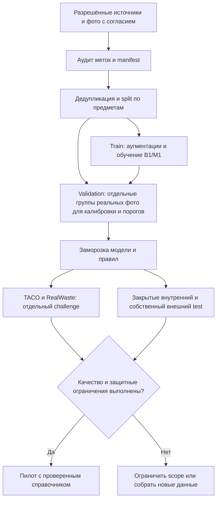
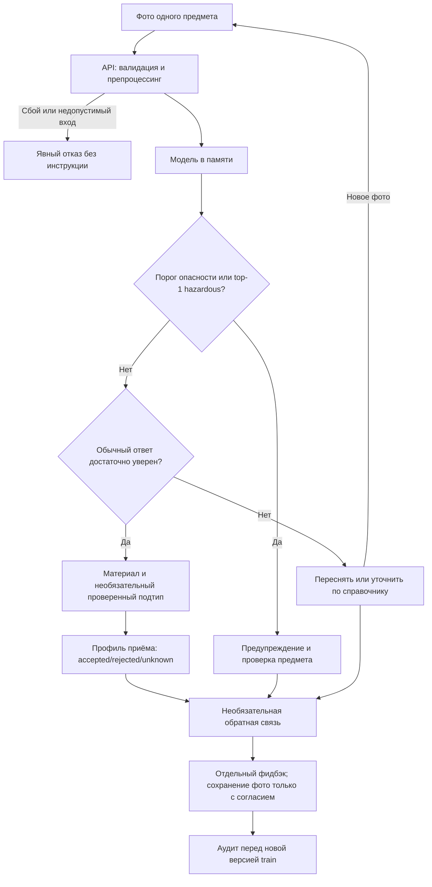

# ML System Design Doc: Waste Sorter

Классификация бытовых отходов по фотографии с осторожной подсказкой по утилизации.

Статус: дизайн ДЗ1. Данные ещё не собраны, EDA, обучение и пилот не проведены.
Все численные цели ниже — проектные гипотезы, а не измеренные результаты.
Основания: [условие ДЗ1](https://gist.github.com/pacifikus/47424379293e0874859354ecd130ba13)
и предоставленные занятия MLSD 1–6. Дизайн пересматривается после EDA;
критерии закрытого теста не меняются после просмотра результатов.

## 1. Цели и предпосылки

### 1.1. Зачем идём в разработку продукта

**Проблема.** Пользователь хочет сортировать отходы, но не знает материал предмета
или правила приёма. Например, форма упаковки не гарантирует состав, а состав сам
по себе не определяет, примет ли её конкретный оператор. Ошибочная подсказка может
загрязнить вторсырьё; пропуск батарейки или лампы имеет более высокую цену.

**Пользователи.** Жители, начинающие сортировать бытовые отходы дома.
Офисы и школы — возможные следующие площадки, но не целевая аудитория первого пилота.
Автор проекта отвечает за данные, эксперимент и приложение; независимый проверяющий
нужен для эталонной разметки и проверки инструкций до оценки качества.

**Бизнес-цель.** Увеличить долю корректно завершённых решений о сортировке и сократить
время поиска относительно краткого текстового справочника. Само число фотографий,
высокий confidence и нажатие «верно» не доказывают полезность продукта.

**Почему пробуем ML.** Фото может сократить поиск материала среди множества предметов.
Это гипотеза: визуально похожие предметы могут иметь разный состав, поэтому сравниваем
с ручным справочником и разрешаем отказ от ответа. Если ML не улучшает процесс,
сохраняем справочник; более сложная модель не является целью сама по себе.

Цепочка эффекта: фото → корректная идентификация → проверенная инструкция → решение
пользователя. Уменьшение реального загрязнения вторсырья потребует отдельного полевого
исследования; учебный пилот его не измеряет.

**Цели будущего MVP:**

| Уровень | Метрика | Проектный ориентир |
|---|---|---|
| Модель | Macro-F1 семи классов без порогов, внутренний закрытый test | ≥ 0.85 |
| Модель | Macro-F1 семи классов на собственном внешнем test | ≥ 0.75, отдельная гипотеза для реальных фото |
| Решение | Точность автоматически принятых обычных ответов | ≥ 0.95 при coverage ≥ 0.75 |
| Защитная | Доля опасных предметов, ошибочно получивших обычную инструкцию | ≤ 0.10 |
| Защитная | Recall предупреждения после решающего правила | ≥ 0.90; до порогов — отдельная диагностика |
| Продукт | Доля корректных решений против справочника | Не хуже; желаемый прирост ≥ 5 п.п. |
| Продукт | Медиана времени решения против справочника | Желаемое сокращение ≥ 20% |
| Система | p95 полного серверного `/predict` | ≤ 500 мс на заданном CPU |

Числа используются для планирования. Успех нельзя объявлять по точечной оценке
при недостаточном числе независимых объектов; протокол интервалов — в п. 2.1.

### 1.2. Бизнес-требования и ограничения

| ID | Требование | Критерий проверки |
|---|---|---|
| BR-01 | Оценить фото одного предмета | Ответ содержит класс или статус отказа, версии модели и правил |
| BR-02 | Не превращать неопределённость в обычную инструкцию | Пустое/неподдерживаемое фото, низкая уверенность и сбой дают явный отказ |
| BR-03 | Отдельно обрабатывать потенциально опасные отходы | Предупреждение имеет приоритет над обычным классом; контроль защитных метрик |
| BR-04 | Отделить материал от правил приёма | Без проверенного профиля оператора ответ о приёме — `unknown` |
| BR-05 | Собирать обратную связь с происхождением метки | Подтверждение пользователя хранится отдельно от проверенной разметки |
| BR-06 | Соблюдать ресурсные ограничения | CPU-инференс, артефакт ≤ 50 МБ, замер задержек и отказов под нагрузкой |
| BR-07 | Воспроизвести эксперимент | Хеши данных, manifest split, seed, код, зависимости и пороги сохранены |

**Региональность.** Для дизайна пилота выбираем Москву и двухпоточную схему
ЭкоЛайн: [описание исполнителя](https://ec-line.ru/rso/).
Профиль `moscow-ecoline-draft-v1`
описывает только обслуживаемые этой схемой площадки, а не все пункты Москвы.
Полный профиль и исключения фиксируем в [отдельном документе](pilot_policy.md).
Перед пользовательским пилотом проверяем актуальность правил на выбранной площадке.

В первой итерации показываем класс материала и общую подсказку
«проверьте правила местного оператора». Без выбранного и проверенного профиля
не обещаем конкретный контейнер и не возвращаем универсальный флаг переработки.
Для пилота инструкций используем только выбранный профиль: до запуска фиксируем
адрес площадки, ссылку на источник, дату проверки и версию профиля. Пока профиль
не готов, можно оценивать материал и usability, но не заявлять успех подсказок по приёму.

**Ограничения.** Один студент; учебная оценка — 50 часов на MVP за семестр:
15 ч данные/аудит, 12 ч baseline/эксперименты, 10 ч API/демо, 8 ч оценка/пилот,
5 ч резерв. После EDA пересматриваем план, при нехватке времени откладываем подклассы
пластика. CPU и существующий компьютер; платные API не нужны. Лимит дополнительных
расходов — 2 000 ₽ на семестр, любая потребность сверх него требует сокращения scope.
Это бюджетное допущение, а не оценка рыночной стоимости разработки.

**Производительность.** Клиент до отправки уменьшает длинную сторону до 1280 px
и сжимает фото до целевого размера ≤ 500 КБ, показывая ошибку, если это не удалось.
Сервер всё равно проверяет собственные лимиты. На канале 20 Мбит/с передача 500 КБ
занимает около 0.2 с без учёта RTT; загрузка исходника 3–4 МБ не укладывается
в обещание секунды. Сжатие на клиенте — план реализации, пока интерфейса нет.

Стартовый стенд: 2 vCPU, 4 ГБ RAM, 1 worker, прогретая модель,
1 запрос/с в течение 10 минут, JPEG/PNG ≤ 5 МБ и ≤ 12 Мп. Считаем p50/p95,
долю ошибок и RSS; в серверную задержку включаем декодирование и препроцессинг,
но не загрузку по сети. Инференс измеряем отдельно. Ориентир end-to-end ≤ 1 с
проверяем отдельно с указанием сети; без такого замера он не считается выполненным.

**Приватность.** По умолчанию фото обрабатывается в памяти без сохранения. Хранение
для исследования — только по отдельному согласию. Удаляем EXIF при перекодировании,
не пишем изображения и payload в логи. EXIF не удаляет лица и текст на фото:
перед включением в датасет проверяем содержимое. Кадры с людьми, документами
и другими личными данными исключаем: согласие загрузившего не означает согласия
посторонних людей. Пересъёмка предмета предпочтительнее сохранения такого кадра.
Добровольно сохранённые исходники удаляем через 30 дней; пользователь может запросить
удаление по случайному ID. Согласие и проверка метки — разные условия включения в train.

### 1.3. Что входит в scope

**ДЗ1:** дизайн, README, пакет классов, pytest, Ruff и pre-commit. Обученной модели,
API и результатов пока нет. Отсутствие реализации этих компонентов не скрывается
за схемой будущей системы.

**MVP:** семь классов; аудит и объединение разрешённых источников; baseline и лёгкая
CNN; отказ от ответа и предупреждение об опасности; FastAPI и веб-демо; отдельный
сбор фидбэка; независимая оценка; ручное переобучение и версии артефактов.

**Условное расширение:** подклассификация пластика только после подтверждения покрытия
и достоверных меток. Она не блокирует базовый MVP. Принятие конкретным оператором
определяется отдельным проверенным профилем, а не головой нейросети.

**Вне scope:** детекция нескольких объектов, OCR маркировки, геолокация и каталог
операторов, мобильное приложение, автоматическое переобучение, физическая сортировка,
гарантия распознавания любых опасных отходов. Конвейер — отдельная будущая задача (п. 6).

Технический долг: веб-демо вместо приложения, SQLite, ручной аудит и публикация модели.
Фиксируем окружение эксперимента вместе с версиями библиотек; текущие диапазоны
в `pyproject.toml` сами по себе не гарантируют воспроизводимость обучения.

### 1.4. Предпосылки решения и данные

| Допущение | Проверка | Если не выполнено |
|---|---|---|
| Один видимый предмет | Инструкция съёмки, challenge с пустыми и многопредметными фото | Пересъёмка; не выдаём одну инструкцию нескольким предметам |
| Материал различим на фото | Проверенная разметка и разбор ошибок | Отказ, запрос маркировки или справочник |
| Источники разрешены к использованию | Проверка лицензии, версии и доступа до загрузки | Исключить источник |
| Есть независимая проверка меток | Второй проверяющий и разбор разногласий | Только предварительный отчёт, без заявления об успехе |
| Реальные фото отличаются от учебных | Закрытый набор телефонов/фонов | Ограничить вывод доменом исходных данных |

Источники — кандидаты, а не уже доступный объединённый датасет. Размеры, лицензии,
классы и соответствия проверяются на конкретном снимке в EDA.

| Источник | Планируемое использование | Ограничение/аудит |
|---|---|---|
| [TrashNet](https://github.com/garythung/trashnet) | Базовые материалы; `cardboard` и `paper` → `paper` | Однородный фон; `trash` не считать автоматически `other` без проверки |
| [Garbage Classification](https://www.kaggle.com/datasets/mostafaabla/garbage-classification) | Цвета стекла → `glass`, `battery` → `hazardous`, `biological` → `organic` | Проверить происхождение и пересечения с другими источниками; батарейки не покрывают все опасные отходы |
| [TACO](http://tacodataset.org/) | Отдельный challenge из кропов | Все кропы исходной сцены в одной группе; перенос категорий требует аудита |
| [WaDaBa](http://wadaba.pcz.pl/) | Только эксперимент PET/HDPE/PP/PS | PVC и LDPE отсутствуют; Other слишком мал. Получение по форме/соглашению — зависимость этапа данных, не гарантированный доступ |
| [RealWaste](https://archive.ics.uci.edu/dataset/908/realwaste) | Только внешний challenge, не train и не калибровка | CC BY 4.0; нет класса hazardous, поэтому не доказывает полноту семиклассового MVP |
| Собственные фото с согласием | Закрытая оценка реальных условий | Группы по физическому предмету/сессии; независимая разметка |

**Покрытие пластика.** По замечанию ревьюера WaDaBa содержит 100 предметов,
снятых с повторными ракурсами: PET 57, HDPE 15, PP 14, PS 13, Other 1.
Это сведения ревью, подлежащие сверке с полученным снимком: опубликованная
[таблица исследования](https://www.oaepublish.com/articles/ir.2021.15) также
подтверждает отсутствие PVC/LDPE и малочисленность Other, но её количества
изображений отличаются от пересказа сайта. Не смешиваем эти версии в одном отчёте.
ID предмета извлекаем из имени файла по проверенной схеме; 40 ракурсов не дают
40 независимых объектов. В 15% test останется примерно по два предмета редких
полимеров: этого недостаточно для подтверждения цели F1. Нужен собственный сбор
новых предметов с маркировкой; если доступ или сбор не получены, расширение отложено.

**Покрытие hazardous.** Начальная подтверждаемая область — батарейки.
Лампы, электроника и другие опасные предметы не обещаются как распознаваемые:
они входят в challenge и запрос уточнения. Расширяем область только после
самостоятельного сбора и проверки соответствующих подклассов. Наличие названия
`hazardous` не делает батарейный test проверкой всех опасных отходов. Числа фото
из ревью не используем как результаты собственного аудита.

**Права на данные.** Garbage Classification включает веб-снимки; автор
[указывает исследовательское использование и права исходных фотографов](https://www.kaggle.com/code/mostafaabla/garbage-classification-keras-transfer-learning/input).
Для каждого источника сохраняем условия конкретного снимка; MIT у кода TACO
не является лицензией всех изображений. Перед использованием его фото проверяем
метаданные прав каждого файла. WaDaBa требует проверки условий выдачи. Эти источники
не считаем автоматически разрешёнными для коммерческого продукта или публичного
распространения весов; при неясных правах используем собственные разрешённые фото.

Для каждого изображения manifest хранит ID, SHA-256, источник/лицензию/версию,
группу предмета/сцены, исходную и целевую метку, происхождение разметки и split.
Неоднозначные метки получают `unresolved`, не подменяются классом `other`.
После аудита публикуем число независимых предметов и распределение классов по источникам.
Ресэмплинг и веса применяем только к train; недостаток покрытия не исправляется весами.

**Матрица относительной цены решений.** Это экспертные приоритеты для обсуждения,
не рубли и не измеренный ущерб. Для принятого оператором предмета обычный совет
верен; «не принят» здесь означает именно выбранную схему, а не универсальное свойство.

| Истинный исход | Верный маршрут | Ошибочно во вторсырьё | Ошибочно в смешанные | Уточнение/отказ |
|---|---|---|---|---|
| Опасный предмет | Специальный сбор: 0 | Очень высокая | Очень высокая | Задержка, отдельное предупреждение обязательно |
| Не принят выбранной схемой | Проверенный иной маршрут: 0 | Высокая: загрязнение | Зависит от правил | Низкая |
| Принят выбранной схемой | Приём вторсырья: 0 | 0 | Средняя: потеря вторсырья | Низкая |

Macro-F1 остаётся диагностикой материала; неравную цену учитывают порядок правил,
защитные метрики и ограничения порогов. До оценки ущерба не оптимизируем выдуманную
денежную функцию потерь.

## 2. Методология

### 2.1. Постановка задачи

**Базовая задача:** single-label классификация одного предмета, семь классов:
`plastic`, `paper`, `glass`, `metal`, `organic`, `hazardous`, `other`.
`other` — проверенный предмет вне первых шести категорий, а не неизвестность модели
и не утверждение о невозможности переработки. Смешанные материалы без однозначной
метки отправляем на разбор; правила для них фиксируются в инструкции разметчика.
`hazardous` оцениваем по фактически собранным подклассам (вначале батарейки);
результат только на батарейках не обобщаем на весь опасный мусор.

**Вход:** JPEG/PNG одного предмета, RGB, resize 224×224 и нормализация выбранного
бэкбона; одинаковый препроцессинг в train и serving. **Выход будущего API:**
`request_id`, `status` (`classified`, `hazard_warning`, `needs_review`, `invalid_input`),
класс/вероятности если доступны, `model_version`, `preprocessing_version`,
`policy_version` или null, `acceptance` (`accepted`, `rejected`, `unknown`).
Timeout и повреждённое фото возвращают типизированную ошибку без рекомендации.
Отсутствие профиля или нужных сведений о предмете означает `acceptance=unknown`.

**Решающее правило, в порядке приоритета:**

1. Проверить формат, размер, декодирование и допустимость входа; при сбое отказать.
   Пустые и неподдерживаемые изображения — отдельный challenge: высокий softmax
   не доказывает, что вход относится к задаче. Автодетектор таких случаев пока гипотеза.
2. Если `p(hazardous) ≥ τ_h`, показать предупреждение о возможной опасности и запросить
   проверку предмета; обычную инструкцию не показывать даже при другом top-1.
3. Иначе, если top-1 = `hazardous`, также показать предупреждение. Если обычный top-1
   имеет `max(p) < τ`, вернуть `needs_review`: переснять/проверить маркировку/справочник.
4. Только уверенный обычный ответ проходит к проверенному профилю приёма.
   Top-3 — варианты для уточнения, а не три одновременные инструкции.

Калибровку и пороги выбираем внутри validation (групповые части для калибровки
и настройки порога). Она включает отдельные реальные фото из целевых условий,
не пересекающиеся с внешним test. Порог со студийных фото сам по себе не гарантирует
95% точности на телефоне. Совместно ищем `τ_h` и `τ`, удовлетворяющие защитной метрике,
точности и coverage. Если совместного решения нет, автоматические советы не запускаем:
обсуждаем scope/данные, не снижаем пороги после просмотра test.

**Пластик — исследовательская ветка.** Четыре кандидата: `pet`, `hdpe`, `pp`, `ps`.
LDPE, PVC и прочий пластик не входят в обучаемую таксономию этой итерации:
ответ для них — «пластик, проверьте маркировку», без догадки и без вывода о приёме.
Даже высокий softmax четырёх классов не доказывает, что неизвестный полимер входит
в поддерживаемый набор: перед автоподтипом нужны challenge и достаточная способность
отказа; до этого подтип остаётся экспериментальным, в пользовательский совет не идёт.
Для каждого типа нужны доступный источник, метка по маркировке/документации,
а не по форме, и независимые предметы. Общий бэкбон с дополнительной головой
сравнивается с отдельным классификатором; loss типа маскируется без достоверной метки.
Ориентир macro-F1 ≥ 0.70 по четырём типам — исследовательский, не gate базового MVP.
Дополнительно считаем сквозное качество на всех истинно пластиковых предметах,
включая ошибки первого уровня, неподдержанные полимеры и отказы. Публикуем
число предметов каждого типа и интервалы, а не только число их снимков.

**Baseline и сравнение:**

- B0: самый частый класс — нижняя граница; не кандидат для пользовательских советов.
- B1: замороженный MobileNetV3, эмбеддинги и логистическая регрессия.
- M1: fine-tuning MobileNetV3; EfficientNet-B0 только при ресурсе на сравнение.
- Для продукта: тот же проверенный текстовый справочник без ML.

Все модели получают одинаковые split и правила оценки; выбор победителя на validation.
Сравниваем macro-F1, защитные метрики, точность/coverage, задержки и размер. Если более
сложная модель не даёт убедительного преимущества при тех же ограничениях, оставляем B1.
Абляции: веса классов и аугментации по отдельности; показываем learning curves.

**Защита от утечки.** Сначала аудит, точная и близкая дедупликация между источниками,
затем групповой train/validation/test примерно 70/15/15 с контролем баланса классов.
Один физический предмет, его ракурсы, одна исходная сцена и её кропы — в одной группе.
При неизвестных группах используем similarity-аудит и явно указываем остаточный риск.
Train-аугментации не попадают в validation/test; любые обучаемые преобразования — только
на train. Seed и manifest split заморожены. TACO-challenge и собственные test-фото
не участвуют ни в обучении, ни в выборе порогов. Повторная разработка после test
требует новой независимой оценки. Отдельно показываем срезы источник/фон/устройство,
редкие классы и новые типы предметов. Внутри train/validation дополнительно
проводим leave-one-dataset-out по доступным источникам: модель не видит исключённый
источник при обучении и настройке. Если класс есть только в исключённом источнике,
фиксируем отсутствие обучающей поддержки, а не скрываем его средним F1.
Окончательные TACO/RealWaste остаются закрытыми и не становятся набором для
повторной настройки по результатам этих опытов.

**Контракты метрик.** Владелец отчёта — автор проекта; источник меток — проверенный
manifest. Окно offline-оценки — замороженная версия test, а не текущий поток фидбэка.

| Метрика | Числитель / знаменатель и обработка отказов |
|---|---|
| Macro-F1 | Среднее F1 семи классов по top-1 до порогов; не исключаем сложные примеры |
| Обычная точность | Верные обычные автоматические ответы / все обычные автоматические ответы |
| Coverage | Число обычных автоматических ответов / все валидные входы основного test |
| Опасная рекомендация | Истинно опасные предметы с обычным автоматическим ответом / все истинно опасные предметы |
| Recall предупреждения | Ответ `hazard_warning` / все истинно опасные предметы после правила, по подклассам |
| Recall top-1 hazardous | Верный top-1 hazardous / все истинно опасные предметы до порогов; диагностика |
| Ложное предупреждение | Предупреждения на неопасных / все неопасные предметы |
| Продуктовая корректность | Верные завершённые решения / все назначенные задания, включая отказ/незавершение |

Показываем также confusion matrix, per-class precision/recall, ECE с размерами бинов,
доли предупреждений/отказов и ошибочных автоматических ответов на challenge.
Отказ не считается верной классификацией; он может предотвратить опасную рекомендацию,
но уменьшает coverage. Top-3 и `needs_review` не считаются обнаружением опасного предмета,
поскольку сами по себе не предупреждают об опасности. Отдельно показываем
опасные обычные ответы, предупреждения, отказы и ошибки API.
При нулевом знаменателе метрика неопределена.

Ориентир после EDA — ≥ 100 независимых предметов на класс в test, включая ≥ 100
опасных из заявленной области (сначала батарейки разных типов). Лампы и техника
попадают в gate только после расширения области и независимого сбора.
Это план сбора, а не гарантия точности оценки:
при recall 0.90 и 100 независимых опасных предметах неопределённость ещё существенна.
Для долей приводим 95% интервалы, для агрегатов и разниц моделей — парный bootstrap
по группам предметов/сессий с полным пересчётом метрик. Для успешного offline-gate
на основном внешнем test нижние границы точности, coverage и recall предупреждения
должны достигать целей, верхняя граница
опасной рекомендации — быть ≤ 0.10; иначе результат предварительный. Не обещаем
доказать прирост 5 п.п. без расчёта мощности. Если данных мало, публикуем ограничение
и план сбора, не выдаём число изображений за число независимых наблюдений.
Отдельно публикуем внутренний F1 (цель 0.85) и внешний F1 на собственных фото
(цель 0.75); внутренний успех не заменяет внешний. Для RealWaste считаем
качество на поддерживаемом пересечении классов с явным mapping; отсутствие
hazardous отмечается, F1 по этому пересечению не сравниваем напрямую с семиклассовым.

### 2.2. Блок-схемы решения

**Обучение и оценка:**

**Будущий инференс:**

### 2.3. Этапы и критерии перехода

| Этап | Выход | Условие перехода |
|---|---|---|
| ДЗ1 | Документ, README, качество кода | Ревью дизайна |
| Данные/EDA | Лицензии, manifest, mapping, аудит дублей и классов | Достаточное независимое покрытие; неподдержанные классы явно ограничены |
| Baseline | B0/B1 и воспроизводимый отчёт | Нет утечки, метрики и ошибки объяснимы |
| Модель | M1, калибровка и пороги | Совместное выполнение целей на validation |
| Закрытая оценка | Интервалы, срезы, challenge | Offline-gate из п. 2.1; при нехватке данных только исследовательский отчёт |
| Сервис | FastAPI, демо, Docker | BR-01–07 и нагрузочный замер |
| Пилот | Независимая проверка и usability-отчёт | Проверенный профиль и протокол п. 3 |
| Расширение пластика | Аудит покрытия и отдельный эксперимент | Не ухудшает базовый классификатор; нет универсальных обещаний переработки |

## 3. Подготовка пилота

**Usability:** 2–5 добровольцев, одна неделя. Проверяем понятность статусов, успешность
загрузки, время и причины отказов. Это малый формативный пилот, не доказательство
роста качества сортировки на популяции.

**Контрольные наборы до пилота.** Первый достижимый этап — 100–200 собственных
фото с независимой разметкой материала и правил выбранной схемы. Часть предметов
выделяем для реальной validation, часть — для закрытого внешнего test; они не
пересекаются ни по предметам, ни по сессиям с train и фидбэком. Это стартовый набор,
не достаточное основание заявить все цели: при нехватке опасных объектов и широких
интервалах gate не пройден. Затем увеличиваем test до покрытия из п. 2.1.
Отдельные 30–50 трудных предметов/кадров: чеки, композитная упаковка, керамика,
плёнка неизвестного полимера, загрязнённая тара, лампы/электроника, несколько предметов,
пустой кадр, человек/документ (только разрешённые тестовые макеты без личных данных).
Для каждого фиксируем требуемое уточнение/предупреждение и допустимость инструкции.
Эти кадры не используются для дообучения или настройки порогов. Если уверенные ошибки
не устраняются, ограничиваем приложение проверенными типами предметов и справочником.
Нельзя автоматически считать, что модель распознала чек по общему классу paper.

**Сравнение со справочником:** до запуска фиксируем набор предметов с проверенными
материалами и правилами выбранного оператора. Задания распределяем между условиями
«справочник» и «ML + тот же справочник», балансируем сложность и порядок.
Стартовый ориентир — 20 разных заданий на участника, распределённых между условиями. Один человек
не решает один и тот же предмет дважды, чтобы не измерять запоминание. Сохраняем
назначение задания, старт, завершение, ответ, версии и факт показа подсказки.
Оценщик сверяет решения с эталоном без знания условия. Разногласия разбираются;
неустановленный эталон исключается с причиной до анализа результатов.

Считаем корректность всех назначенных заданий, время завершённых и долю незавершений
по условиям. Для времени вместе с медианой обязательно показываем незавершения,
иначе быстрые отказы создадут ложный выигрыш. Интервалы учитывают повторные задания
участников и предметов; до расширенного пилота оцениваем требуемое число участников
и заданий по вариативности и целевому приросту 5 п.п. Если данных не хватает,
формулируем вывод как наблюдение о usability, а не подтверждённый эффект.

**Обратная связь не эталон.** Нажатия «верно/неверно» — сигналы доверия и кандидаты
на аудит; отсутствие оценки не считается успехом. В train поступают только фото
с согласием, проверенной меткой и отсутствием пересечений с закрытыми наборами.

**Решение после пилота:** продолжаем, если нет нарушения защитных ограничений,
есть проверяемая польза и ресурс на поддержку. При опасных автоматических советах
останавливаем выдачу инструкций и оставляем справочник. Если эффект неопределён,
расширяем независимую оценку; если справочник не хуже, упрощаем продукт.

## 4. Внедрение, мониторинг и риски

Будущая архитектура: веб-демо → FastAPI → CPU-модель в памяти процесса → отдельный
профиль правил; SQLite для добровольного фидбэка. Docker, фиксированные версии
модели/препроцессинга/правил; предыдущий проверенный артефакт для rollback.
При недоступности модели — справочник и явный отказ, без выдуманного результата.

Контролируем задержки, RSS, ошибки, отказы, предупреждения, распределение классов
и coverage. Дрейф confidence — сигнал проверки, не доказательство падения качества.
Качество измеряется по отдельно проверяемой выборке с известной задержкой разметки.
Перед каждой публикацией — неизменяемый regression-набор, проверка совместимости
препроцессинга, лимитов входа и отказов. Переобучение вручную после аудита.

| Риск | Проверка и реакция |
|---|---|
| Domain shift | Срезы реальных телефонов/фонов; ограничение домена и целевой сбор |
| Недостаток опасных подклассов | Отдельные counts/recall по подклассам; не обобщать батарейки на лампы |
| Визуально одинаковые полимеры | Подтверждённые метки, отказ и запрос маркировки |
| Ошибочные или устаревшие правила | Официальный источник, дата/версия, неизвестность без профиля |
| Дубли между источниками | Хеши, similarity и групповой split до аугментаций |
| Шум и смещение фидбэка | Независимая разметка; не обучаться на подтверждении автоматически |
| Пустое/многопредметное фото с высоким score | Отдельный challenge; если отказы ненадёжны, ограничить демо контролируемой съёмкой |
| Утечка личных данных | Согласие, отсутствие фото в логах, аудит содержимого, срок удаления |
| Цели несовместимы или бюджет исчерпан | Сохранить baseline/справочник, отложить подтипы и расширить сбор |

## 5. Открытые вопросы

- Какую конкретную площадку московской схемы ЭкоЛайн включаем в пилот и кто проверит профиль?
- Кто выполнит независимый аудит материалов и спорных меток?
- Какие опасные подклассы и полимеры реально покрыты разрешёнными данными?
- Можно ли получить достаточное число независимых реальных предметов для test?
- Достаточны ли контролируемая съёмка и отказ для неподдерживаемых входов?

Эти вопросы не мешают ревью ДЗ1, но блокируют заявления о качестве и запуск советов.

## 6. План на будущее: конвейер

Детекция и трекинг нескольких предметов на ленте — отдельный проект с другими
данными, оборудованием, ограничениями задержки и ценой ошибки. Можно переиспользовать
аудит данных и часть представлений, но не считать качество классификатора телефона
доказательством пригодности для сортировочной станции. До прототипа нужны доступ
к записям станции, согласованная таксономия, протокол задержек и безопасная интеграция
с исполнительными механизмами. Промышленные подходы используют, в частности, NIR-спектроскопию
([обзор в исследовании](https://www.oaepublish.com/articles/ir.2021.15));
RGB-распознавание полимеров остаётся гипотезой;
выбор дополнительных сенсоров требует отдельного исследования.
