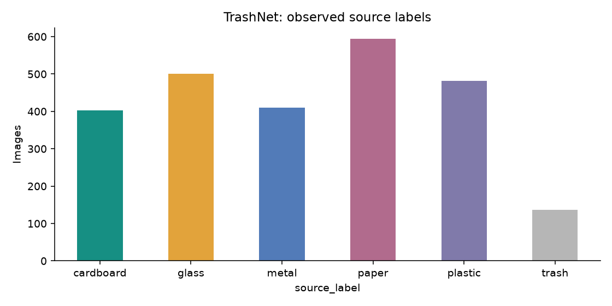
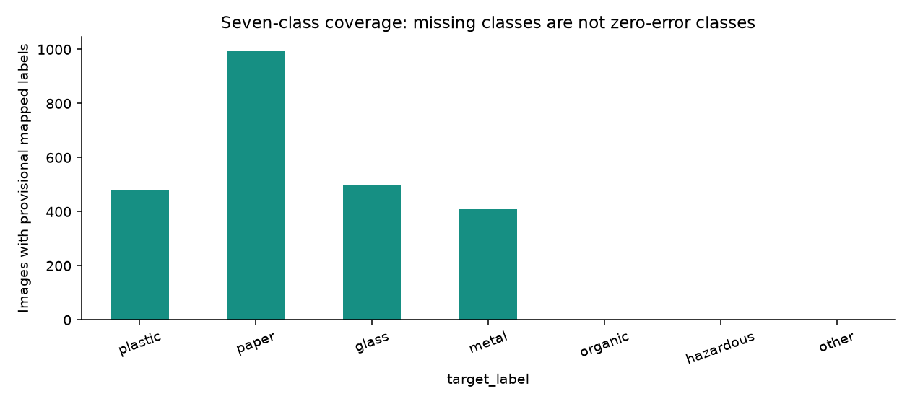
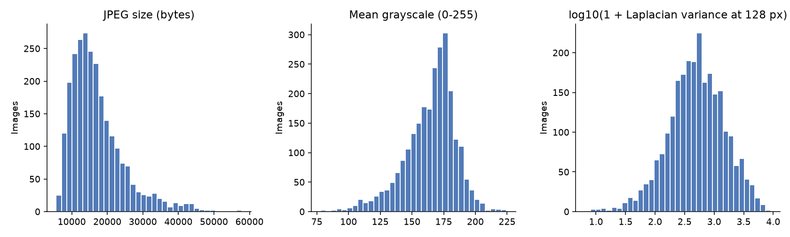
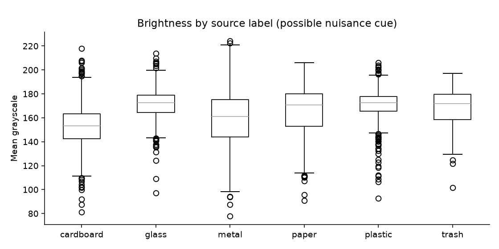
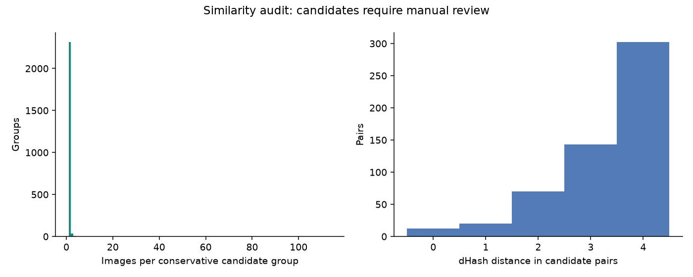
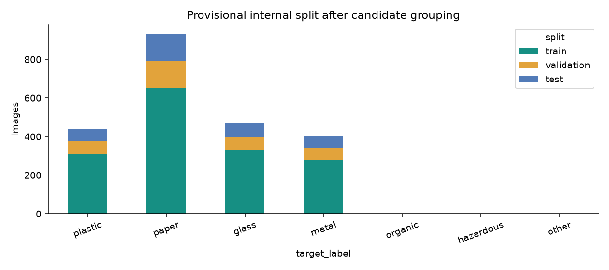
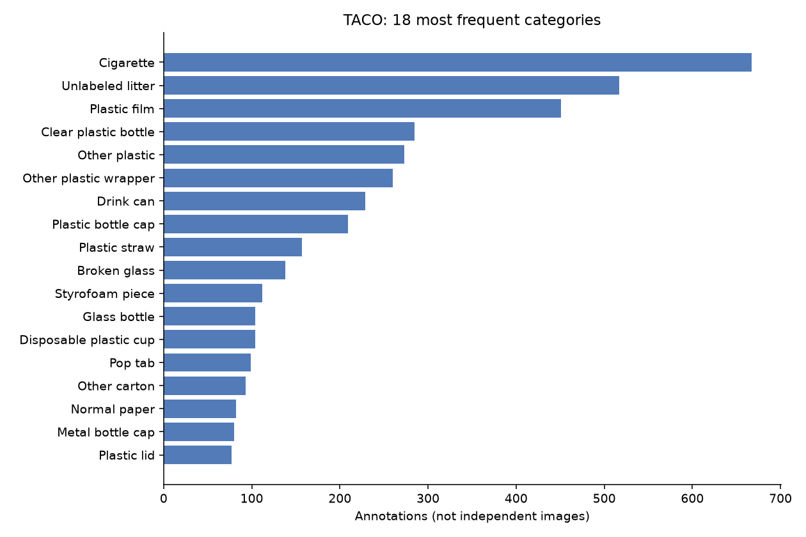
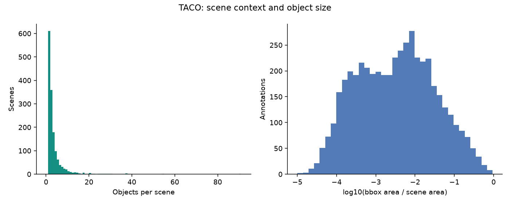
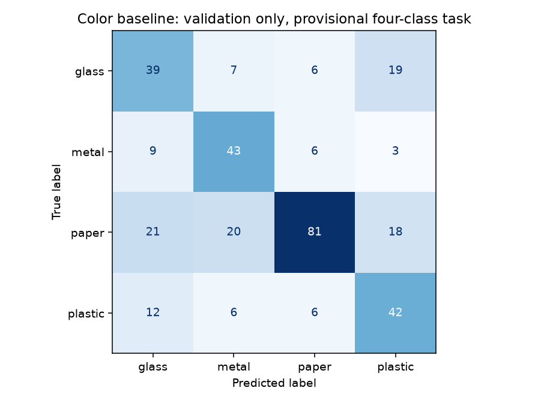

# EDA Waste Sorter — ДЗ2

Дата анализа: **14.11.2026**. Цель — проверить, какие данные действительно есть
для классификации материала одного предмета, где разметка противоречива
и можно ли честно оценить заявленные семь классов.

**Главный результат:** доступного TrashNet достаточно для предварительного
эксперимента с четырьмя материалами, но недостаточно для семиклассового MVP.
Обнаружены точные дубли с разными метками. Аннотации TACO показывают редкость
опасных предметов и содержат ошибки; это не готовый дополнительный train.

## 1. Что именно исследовано

| Источник | Фактически загружено и проверено | Роль и ограничения |
|---|---|---|
| [TrashNet](https://github.com/garythung/trashnet) | Полный `dataset-resized.zip`, все 2 527 JPEG декодированы | Пиксельный аудит и предварительный внутренний split; не исходные полноразмерные фото |
| [TACO](https://github.com/pedropro/TACO) | Полный официальный `annotations.json`: 1 500 сцен, 4 784 объекта, 60 категорий | Аудит схемы/покрытия/рамок и прав; изображения не загружены, качество пикселей не проверено |
| Garbage Classification, WaDaBa, RealWaste, собственные фото | Не загружены в этой итерации | Только кандидаты/план сбора; результаты EDA им не приписываются |

Версии и SHA-256: [configs/data_sources.json](../../configs/data_sources.json).
TrashNet revision `6fa2b878c6c1b4304b91109070ce0edf9279bb31`,
TACO revision `70479ad9adc3da971a8ae75ac97eb1026910eec7`.
Числа ниже вычислены по этим файлам, а не перенесены из карточек датасетов.

Исходные изображения не включены в git. У TrashNet в репозитории опубликована
[MIT-лицензия](https://github.com/garythung/trashnet/blob/6fa2b878c6c1b4304b91109070ce0edf9279bb31/LICENSE);
атрибуция: Gary Thung и Mindy Yang, TrashNet, 2016–2017.
Для TACO наличие MIT у toolkit не разрешает автоматически все фотографии.
У 715 сцен в изученном снимке отсутствует license ID, список `licenses` пуст:
права на фото требуют отдельной проверки до их использования. У остальных 785 сцен
ID есть, но без определений из `licenses` его недостаточно для установления условий.
Таким образом, проверенными правами из одного этого JSON не покрыта ни одна сцена.

## 2. Состав и таксономия



| Исходная метка | Изображений | Целевая метка |
|---|---:|---|
| cardboard | 403 | paper |
| paper | 594 | paper |
| glass | 501 | glass |
| plastic | 482 | plastic |
| metal | 410 | metal |
| trash | 137 | Не установлена, требуется разбор |

**Вывод.** Исходный дисбаланс достигает 594/137 = 4.34 раза. После объединения
бумаги и картона `paper` содержит 997 примеров против 410 у metal (2.43 раза).
Accuracy и предсказание одного частого класса скрывают ошибки остальных материалов;
основной метрикой остаётся macro-F1, дополнительно нужны per-class precision/recall.



**Вывод.** Отсутствуют `organic`, `hazardous` и проверенный `other`.
Метка `trash` описывает неоднородную остаточную категорию, а не конкретный материал.
Она не является доказательством ни класса `other`, ни непригодности для переработки.
В `plastic` нет меток полимера: по нему нельзя обучить PET/HDPE/PP/PS.
В ДЗ2 используется только предварительное сопоставление четырёх материалов,
не независимая экспертная верификация каждого исходного label.

## 3. Техническое качество изображений

Все 2 527 изображений прочитаны: **0 ошибок декодирования**, все **512×384**, **RGB**.
Суммарный размер самих JPEG — 43 282 402 байта, исходного ZIP — 42 834 870 байт.
Нечитаемые файлы не отбрасываются молча: код сохраняет их в manifest с причиной.



Медиана яркости — **168.41/255**, медиана дисперсии лапласиана — **511.70**
на фиксированном grayscale resize 128×128. Порог std < 15 помечает **34** кадра,
дисперсия лапласиана < 50 — **65**. Оба показателя — эвристики для просмотра,
а не готовые критерии удаления. Масштаб измерения зафиксирован, потому что
резкость сильно зависит от resize.

**Вывод.** Размеров достаточно для входа 224×224, но это ещё не означает,
что предмет хорошо виден. По флагам нельзя автоматически отбрасывать прозрачную
тару или гладкую бумагу: они могут выглядеть малоконтрастными и без дефекта съёмки.



**Вывод.** Распределения яркости различаются между группами изображений.
График не доказывает причинную связь с меткой: фон, прозрачность, отражения и освещение
могут быть вспомогательными сигналами, которые не перенесутся на фото с кухни.
Нужны абляции фона и внешний набор, а не только повышение внутреннего F1.

### Визуальный скрининг

Просмотрено **30 изображений**, по 5 на исходный класс, выборка с seed 42.
ID и наблюдения: [visual_review.csv](visual_review.csv).
Это визуальный скрининг ассистентом, не независимая экспертная разметка;
исходные labels по его результатам автоматически не менялись.

В выборке видны крупные планы с обрезанным предметом, блики и прозрачная тара,
текст на бумаге/этикетках и неоднозначный состав `trash`. Например,
`cardboard354.jpg` почти полностью занят гладкой поверхностью, а `trash23.jpg`
похож на смятый бумагообразный материал. Полимер на выбранных фото пластика
не подтверждён читаемой маркировкой. Это поддерживает решение запросить уточнение,
а не переименовать неоднозначные снимки по внешнему виду.

EXIF не обнаружен во всех изученных JPEG. **Это не проверка отсутствия PII в пикселях.**
Полного аудита людей/документов/идентифицирующего текста не было. Новые собственные
фото проходят отдельную проверку и хранятся только с согласием; срок и удаление
описаны в дизайн-документе. В отчёте опубликованы статистики и относительные ID,
а исходные контактные листы и фотографии остаются в игнорируемой `data/`.

## 4. Дубли, ошибки меток и ограничения группировки

Найдены **3 пары одинаковых файлов** (совпадают SHA-256 и декодированные пиксели),
причём каждая пара имеет противоречащие друг другу исходные метки:

| Первая запись | Вторая запись |
|---|---|
| glass/glass115.jpg | metal/metal91.jpg |
| glass/glass176.jpg | plastic/plastic152.jpg |
| glass/glass389.jpg | plastic/plastic332.jpg |

**Вывод.** Даже разные классы не гарантируют независимых изображений.
Такие пары нельзя разнести между train/test или без проверки выбрать одну метку.
Они находятся в карантине конфликтов; одинаковый кадр не должен повышать вес
одного предмета в train или число независимых test-наблюдений.



dHash на grayscale 9×8, Hamming distance ≤ 4 даёт **547 candidate-пар**,
из них **273** между разными исходными метками. Объединение связанных пар
даёт 2 354 candidate-группы, включая 42 группы с несколькими изображениями;
наибольшая содержит 113 кадров. Это не 2 354 подтверждённых физических предмета.

Дополнительно просмотрены 3 точные пары и 7 выбранных cross-label dHash-пар.
В точных парах действительно совпадают изображения. Среди 7 неточных пар видны
ложные совпадения: например, `cardboard83.jpg` и `glass5.jpg` имеют похожую
гладкую композицию, но показывают разные поверхности/предметы.
Эта целевая выборка не даёт общей оценки precision метода.

**Вывод.** dHash полезен как очередь разбора, но не как автоматическая переразметка
или доказательство идентичности предмета. В текущем split связанные кандидаты
не разделяются, а группы с противоречащими целевыми метками удерживаются целиком.
Это сознательно консервативное, предварительное решение. Оно исключает часть
нормальных изображений и меняет состав выборки; до финальной оценки нужны ручной
разбор групп и/или настоящие object/session ID. Разные ракурсы одного предмета
dHash может не найти, поэтому остаточный риск утечки остаётся.

## 5. Предварительный внутренний split



Seed **42**, stratification по целевой метке candidate-группы, примерно 70/15/15.
Группы с `trash`, нечитабельными файлами или конфликтами меток не отправляются
в модель. В этой версии получилось:

| Материал | Train | Validation | Test | В карантине среди этих четырёх меток |
|---|---:|---:|---:|---:|
| glass | 327 | 71 | 72 | 31 |
| metal | 280 | 61 | 63 | 6 |
| paper | 651 | 140 | 143 | 63 |
| plastic | 310 | 66 | 65 | 41 |
| **Итого** | **1 568** | **338** | **343** | **141** |

Ещё **137** изображений `trash` не имеют установленной целевой метки.
Всего исключено **278**, 2 249 изображений распределено между тремя частями.
Из-за приоритета причины конфликта в колонке `exclusion_reason` отмечено
145 конфликтных записей и 133 unresolved; это не дополнительные изображения
сверх 278. Полный manifest содержит все 2 527 строк.

Проверка пересечений известных candidate-групп: **0**.
**Вывод.** Такая проверка защищает от найденных повторов, но не подтверждает
полную независимость физических предметов. Это внутренняя, предварительная
оценка на одном источнике. Test составлен и проверен в EDA, но метрики моделей
на нём не вычислялись. Настоящий внешний test и реальная validation ещё нужны.

## 6. TACO: пригодность аннотаций для нашей задачи



| Категория | Аннотаций |
|---|---:|
| Cigarette | 667 |
| Unlabeled litter | 517 |
| Plastic film | 451 |
| Battery | **2** |
| Food waste | **8** |
| Drink carton | 45 |

Полная таблица с числом сцен и предварительным mapping:
[taco_categories.csv](taco_categories.csv). Композиты, неустановленные материалы
и неоднозначные категории остаются `needs_review`; mapped материал не означает
автоматическое принятие конкретным оператором.

**Вывод.** 4 784 аннотации — не 4 784 независимых объекта для train/test.
Две батарейки не позволяют подтвердить recall 0.90; 8 Food waste не решают проблему
отсутствующего organic. Категории полимеров не появляются из названия пластиковой
бутылки. TACO остаётся кандидатом на challenge, а не дополнением, которое
автоматически закрывает семь классов.



**890 из 1 500 сцен** содержат более одного размеченного объекта (59.33%),
максимум — **90**. У **67.20%** рамок площадь меньше 1% площади сцены.
Размер рассчитан по bbox, а не по segmentation mask. Кропы одной сцены должны
оставаться вместе; внешний тест на точном bbox проще, чем съёмка пользователя
без подсказанного положения предмета.

Ссылки image/category корректны у всех аннотаций, но найдены **7 некорректных bbox**
и **2 повтора annotation ID**. Проверка bbox: положительные размеры, координаты
внутри сцены с допуском 1 px. Подробные строки:
[taco_annotation_audit.csv](taco_annotation_audit.csv).
Пустых по числу аннотаций сцен нет. Целостность segmentation mask в этом анализе
не проверялась. В [taco_scenes.csv](taco_scenes.csv) — размер сцены, число объектов
и известность license ID; отсутствующий ID не равен установленному запрету,
но требует отдельного разбора прав.

**Вывод.** Перед кропами нужны проверка/карантин bbox и ID, аудит прав и просмотр
самих изображений. Исправлять ошибки путём тихого clamp рамки или перезаписи
аннотаций с одинаковым ID нельзя.

## 7. Простой baseline на validation

Для проверки работоспособности моделирования дополнительно запущены два baseline.
Оба обучены на одном train и оценены только на validation четырёх материалов.
Перед обучением повторные decoded pixels удаляются; в активных частях этой версии
точных дублей уже нет, поскольку конфликтные группы в карантине.

| Модель | Macro-F1 | Accuracy |
|---|---:|---:|
| B0: самый частый класс train (`paper`) | 0.1464 | 0.4142 |
| B_color: RGB-гистограммы + логистическая регрессия | **0.5966** | **0.6065** |

B_color: resize RGB 64×64, по 16 bins на канал + mean/std, всего 54 признака;
train-only StandardScaler; balanced class weights, C=1, max_iter=2000, seed=42.
Подбор гиперпараметров и аугментации не проводились. Это дешёвый цветовой baseline,
**не** замороженные CNN-эмбеддинги и не полноценная система сортировки.



| Материал | Precision | Recall | F1 | Validation |
|---|---:|---:|---:|---:|
| glass | 0.4815 | 0.5493 | 0.5132 | 71 |
| metal | 0.5658 | 0.7049 | 0.6277 | 61 |
| paper | 0.8182 | 0.5786 | 0.6778 | 140 |
| plastic | 0.5122 | 0.6364 | 0.5676 | 66 |

**Вывод.** Даже глобальные цветовые признаки дают сигнал на одном источнике,
но стекло и пластик различаются плохо. Рост относительно B0 не доказывает,
что определён материал или что результат перенесётся на иной фон.
Семиклассовую цель F1 0.85, hazardous recall и правила приёма этим результатом
не проверяли. Доверительный вывод о превосходстве модели на реальных предметах
не делается. Следующий шаг — B1 с замороженным бэкбоном, затем новые реальные
независимые данные, а не подбор модели по текущему test.

Метрики и recipe: [baseline_metrics.json](baseline_metrics.json).
Все validation-predictions: [baseline_validation_predictions.csv](baseline_validation_predictions.csv).

## 8. Что меняется в плане проекта

1. Не запускать пользовательские советы и семь классов на имеющемся train.
2. Разобрать точные конфликтные дубли и candidate-группы, выпустить следующую версию split.
3. Собрать недостающие organic/hazardous/проверенный other и настоящие object/session ID.
4. Первый ориентир — по 300 уникальных предметов отсутствующих классов (минимум 900);
   это всё ещё мало для строгой test-оценки. Для итогового gate нужны ≥ 100
   независимых test-предметов на заявленный класс и соответствующие интервалы.
5. Отдельно подготовить 100–200 своих фото для ранней real-validation/test по разным
   предметам и 30–50 трудных примеров. Не считать это достаточным финальным тестом.
6. Полимеры отложить до подтверждённых маркировкой меток и независимых предметов.
7. TACO не включать в train; до challenge проверить права, bbox, ID и сами фото.
8. Проверить предложенную в ДЗ1 схему приёма отдельно от предсказания материала.

Подробные этапы, losses, валидация, риски и выходы:
[дизайн-документ, п. 2.3](../../docs/ml_system_design_doc.md#23-этапы-решения-задачи).

## 9. Воспроизведение

Нужен Python **3.11+**. Анализ выполнен на **3.11.18**; прямые версии библиотек
сохранены в [environment.txt](environment.txt), полный набор —
[requirements/hw2.txt](../../requirements/hw2.txt).

```bash
python3.11 -m venv .venv
source .venv/bin/activate
pip install -c requirements/hw2.txt -e ".[dev,eda]"
python scripts/download_data.py
python -m waste_sorter.eda
python -m waste_sorter.baseline
pytest -q
ruff check .
ruff format --check .
pre-commit run --all-files
```

Для первого download нужен интернет, далее используются проверенные локальные файлы.
В окружении без домашнего каталога для кеша Matplotlib можно задать
`MPLCONFIGDIR=/tmp/waste-sorter-matplotlib`. Скрипты не распаковывают ZIP в файловую
систему и не публикуют оригиналы. Без обоих закреплённых входов анализ завершится
ошибкой, не создавая фиктивные данные. Несовпадение checksum также блокирует запуск.

`visual_review.csv` — отдельные наблюдения по фиксированной выборке; он не выдаётся
за автоматически воспроизводимую экспертную разметку. Все остальные таблицы,
метрики и графики строятся кодом по закреплённым входам.

Проверка воспроизводимости: два последовательных прогона EDA и повтор baseline
дали одинаковые SHA-256 у 18 проверенных артефактов. Проверки кода на Python 3.11:
**15 тестов прошли**, Ruff lint и форматирование прошли. Это проверка реализации
анализа, а не независимое подтверждение материалов или пригодности MVP.
